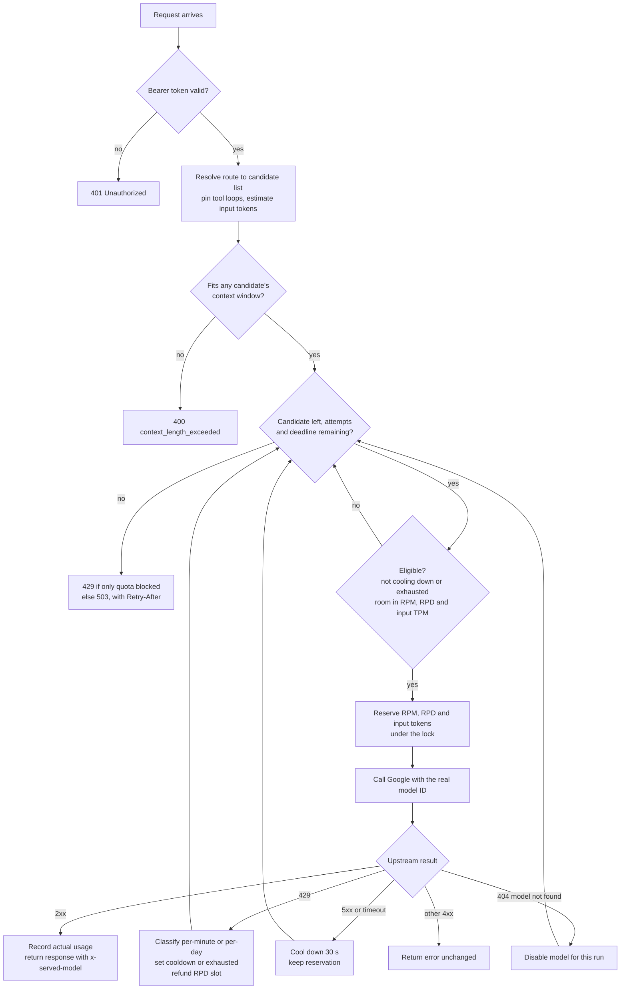
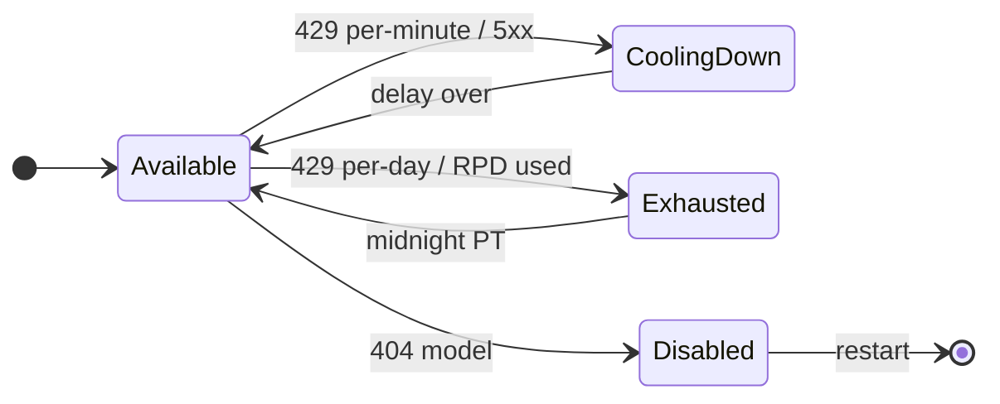
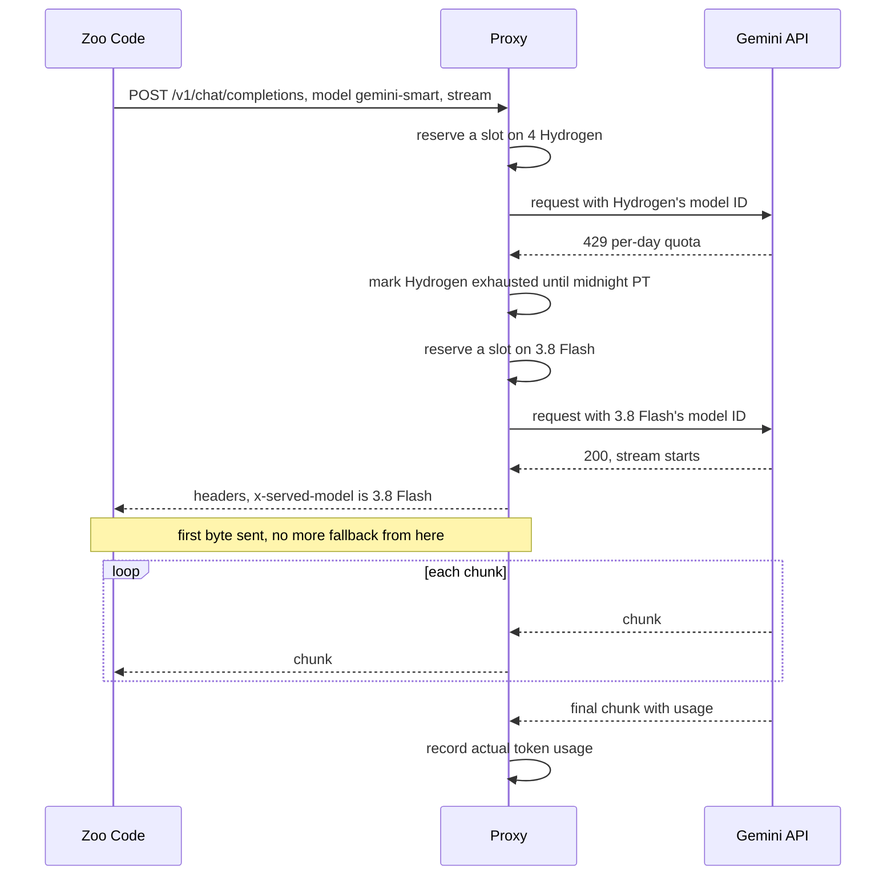

# Design: quota-aware fallback router for the Gemini API

Status: **revision 2, approved 2026-11-20** (after the first Phase 0 probe run and two
external reviews). Phase 1 (core logic, no HTTP) is implemented in `quota_router/`.
Project name: `quota-router-for-gemini`. License: MIT.

## 0. v1 scope

v1 is deliberately small. Everything else in this document is the intended
direction, and is added only once v1 works and the probe supports it.

- **One route**, `gemini-fast`, with **one model**: Gemini 3.5 Flash Lite (500 RPD, 15 RPM).
  Gemini 3.1 Flash Lite (also 500 RPD) joins as the second candidate once it passes a tool
  call: in Phase 0 it returned 503 on all three tool-call requests (2026-11-20), and
  v1 traffic is mostly tool calls from Zoo Code. Until then, v1 has nothing to fall back to.
  The fallback logic is still built and tested in full against mocked upstreams.
- **One uvicorn worker.** Quota state lives in that process's memory.
- **One tested client**: Zoo Code.
- **Tool turns are pinned** to the model that made the tool calls (§5.1). There is no handoff
  between models in v1.
- Deferred until after v1: `gemini-smart`, `gemini-auto` (§16), Copilot Chat, Gemma.

The configuration format stays general (any number of models and routes), so adding
the deferred parts changes config, not code.

## 1. Problem

Google AI Studio's free tier sets limits for each model, in requests per minute (RPM),
tokens per minute (TPM) and requests per day (RPD). Coding agents such as Zoo Code make
many requests per task, so they use up a 20-RPD model within minutes. Most
OpenAI-compatible clients don't switch models when Gemini returns `429 RESOURCE_EXHAUSTED`.

The goal is one local OpenAI-compatible endpoint that sends each request to the best
model that still has quota. Every request stays within Google's published limits for
**one project and one API key**.

### Non-goals

- Raising limits. We never rotate several API keys, projects or accounts, and never
  retry to get past a limit. See [COMPLIANCE.md](COMPLIANCE.md).
- Hosting the proxy for other people. Each user runs their own instance with their own key.
- Spending money. The proxy uses the Gemini API's free quota, which a project without
  billing gets at no cost, and never runs against a billed project, where every call is
  charged (§19.1). Quota from paid Google plans (the Gemini app, Antigravity, the AI Studio
  web page) can only be used inside those apps; the API can't reach it.
- Translating between API formats. Google's OpenAI-compatible endpoint does that.
- Live API, TTS, embeddings, image, video or music models.

## 2. Quota inventory (one project, free tier, observed 2026-11-20)

These are the limits one project showed in AI Studio on 2026-11-20. They are a
**snapshot, not a constant**: limits differ between projects and change over time. Each
user copies their own project's active limits into `config.yaml`. Model IDs were confirmed
through `models.list` in Phase 0 ([probe-results.md](probe-results.md)).

TPM counts **input** tokens per minute. Output and reasoning tokens don't count
against it (§7).

| Display name | Model ID | RPM | TPM (input) | RPD | Role |
|---|---|---|---|---|---|
| Gemini 4 Hydrogen | `gemini-4-hydrogen` | 5 | 250K | 20 | smart |
| Gemini 3.8 Flash | `gemini-3.8-flash` | 5 | 250K | 20 | smart |
| Gemini 3.6 Flash | `gemini-3.6-flash` | 5 | 250K | 20 | smart |
| Gemini 3 Flash | `gemini-3-flash-preview` | 5 | 250K | 20 | smart / fast tail |
| Gemini 2.5 Flash | `gemini-2.5-flash` | 5 | 250K | 20 | smart / fast tail |
| Gemini 3.5 Flash Lite | `gemini-3.5-flash-lite` | 15 | 250K | 500 | fast (bulk), **v1** |
| Gemini 3.1 Flash Lite | `gemini-3.1-flash-lite` | 15 | 250K | 500 | fast (bulk); after its tool call passes |
| Gemini 2.5 Flash Lite | `gemini-2.5-flash-lite` | 10 | 250K | 20 | fast |
| Gemma 4 31B | `gemma-4-31b-it` | 30 | **16K** | 14.4K | probed in Phase 0; route added after v1 |
| Gemma 4 26B | `gemma-4-26b-a4b-it` | 30 | **16K** | 14.4K | probed in Phase 0; route added after v1 |

In that snapshot the Gemini text models total **about 1,120 RPD**. Gemma adds 28.8K RPD,
but only for prompts small enough to fit its 16K TPM.

Excluded:

- Models with a 0/0 quota.
- Robotics ER 2: a specialised preview model that adds only 20 RPD (about 2%). It is probed in
  Phase 0 but stays out of all routes.
- Antigravity and Decision API. These are separate products, not chat-completion models.
- Live API models. They use a separate real-time protocol, and using them for text
  would not be "the means described in the documentation".

Quotas change. The registry lives in `config.yaml`, not in code. Another account, or this
one after an upgrade, can have different models and limits; §19 covers what changes.

## 3. Architecture

```
client (Zoo Code, Copilot Chat, scripts)
   │  OpenAI Chat Completions, Authorization: Bearer <PROXY_TOKEN>
   ▼
┌──────────────────────── quota-router (127.0.0.1:4000) ───────────────────────┐
│ HTTP layer   FastAPI: /v1/chat/completions, /v1/models, /status, /healthz    │
│ Router       virtual model → ordered candidates → first eligible model       │
│ Quota store  per-model RPM/TPM windows + RPD counter + cooldown/exhausted    │
│              in memory; RPD, exhausted state, tool affinity in SQLite        │
│ 429 reader   decides whether the limit hit is per-minute, per-day or tokens  │
│ Upstream     httpx → https://generativelanguage.googleapis.com/v1beta/openai/│
└──────────────────────────────────────────────────────────────────────────────┘
```

Stack: Python 3.12, FastAPI + uvicorn, httpx, pydantic, PyYAML and stdlib `sqlite3`,
packaged as a Docker image with pinned, hash-locked dependencies.

## 4. Routes (virtual models)

The client picks a virtual model. Order is set in config; the defaults are:

| Route | Candidates in order | Intended use |
|---|---|---|
| `gemini-smart` | 4 Hydrogen → 3.8 Flash → 3.6 Flash → 3 Flash → 2.5 Flash → 3.5 Flash Lite → 3.1 Flash Lite → 2.5 Flash Lite | planning, debugging (Zoo Code Architect/Debug) |
| `gemini-fast` | 3.5 Flash Lite → 3.1 Flash Lite → 2.5 Flash Lite → 2.5 Flash → 3 Flash | edits, tool loops (Zoo Code Code/Ask); never uses the top three smart models |

The models named here are from the account in §2; other accounts route their own models.
v1 ships only `gemini-fast`, with just its first candidate (§0). The full lists above
are the target once v1 works. A `gemma-small` route for short prompts (Gemma 4 31B → 26B → `gemini-fast`)
will be added after v1 if Phase 0 shows Gemma works well enough; it needs routes that can fall back into other routes.

Requesting a real model ID directly sends the request to that model alone, with quota
tracking but no fallback.

## 5. Request flow



1. **Authenticate** the bearer token, using a constant-time comparison. Return 401 if it fails.
2. **Resolve** the route to its candidate list. If the request continues a tool loop,
   the list may be narrowed to one model (§5.1).
3. **Estimate** the input size: `input ≈ chars/4 × 1.2 safety margin`, counting messages and
   tool definitions. Only input counts against TPM. Output is checked separately:
   - *Context fit*: a candidate fits if `input ≤ min(input_limit, tpm_input)` and
     `max_tokens ≤ output_limit`. The limits come from `config.yaml` and are seeded from
     `models.list`. The TPM term matters: the Flash models accept 1M tokens of context, but
     a prompt over 250K could never fit their minute window. If no candidate fits, return `400` with code
     `context_length_exceeded` (the OpenAI convention, which clients use to trigger
     context condensing) without calling upstream.
4. **For each candidate**, while attempts and the deadline remain (§9):
   1. *Eligibility check* (under one `asyncio.Lock`): skip the model if it is
      `exhausted_until > now`, `cooldown_until > now`, RPM window is full, RPD counter is at
      its limit, the request doesn't fit its context, or `input` exceeds the free space in
      its TPM window. Skipping costs nothing; only real calls count as attempts.
   2. *Reserve* one RPM slot, one RPD slot and `input` tokens, still under the same lock.
      Reserving under the lock keeps parallel requests from over-committing.
   3. *Call upstream* with `model` rewritten to the real ID.
   4. *Outcome*:
      - **2xx**: replace the estimated token count with actual usage (see §7). Return the response.
      - **429**: classify it (§6) and set the cooldown or exhausted state. Refund the RPD
        reservation; Google's 429 is the source of truth. Keep the RPM slot, which is the
        conservative choice. Try the next candidate.
      - **500/502/503/504, or a timeout or network error before the first byte**: set a
        short cooldown (30 s) and try the next candidate. Keep the reservation, because the
        request may still have used quota.
      - **The request never left the machine** (connect error, connect timeout, connection-pool
        timeout, or a failure before sending started): the same 30 s cooldown, but refund the RPD
        reservation and keep the RPM slot, as for a 429. Google never saw the request, and
        a model blocked locally is never called again, so nothing would correct the count:
        a network outage of a few minutes would otherwise use up a scarce model's day.
        (Added 2026-11-21 after the Phase 4 review.)
      - **400/401/403/404/422**: return the error to the client unchanged. It is the
        client's or the configuration's problem, and switching models won't fix it.
        Exception: a 404 "model not found" marks that model as disabled for this run
        (misconfiguration) and falls back.
5. **Nothing served the request.** Each candidate ends with exactly one reason:

   | Reason | Means | Can serve later? |
   |---|---|---|
   | `disabled` | 404 model not found earlier in this run | no (until restart) |
   | `too_large` | request doesn't fit its context, output or TPM limit | no |
   | `quota` | skipped for RPM, RPD, TPM, cooldown after a 429 or exhausted state, or it answered 429 | yes, at its `ready_at` |
   | `unavailable` | 5xx, timeout, or cooldown after a 5xx | yes, at its `ready_at` |
   | `not_tried` | attempts or deadline ran out before reaching it | yes, now |

   `ready_at` is the earliest moment the model could take *this* request: the latest of
   its cooldown end, exhausted-until, the next free RPM slot and the time its TPM window
   has room for this request's input.

   Rules, applied in order (candidates = after pinning):
   1. Every candidate is `disabled` or `too_large`: if any is `too_large`, return
      **400** `context_length_exceeded`. Otherwise (all `disabled`) return **503** with no
      `Retry-After` and code `no_enabled_model`, and log an error. This is a configuration
      fault, and retrying won't help.
   2. Otherwise, ignore the `disabled` and `too_large` candidates. If all the rest are
      `quota`: **429**.
   3. Otherwise (any `unavailable` or `not_tried`, or the deadline ran out): **503**.
   4. `Retry-After` (rules 2 and 3) = seconds until the earliest `ready_at` among the
      remaining candidates (`not_tried` counts as now), rounded up and at least 1.
      It is never derived from a model that can't serve the request.

   Errors are in OpenAI format, and the message lists each candidate with its reason.

Every response carries `x-served-model` and `x-fallback-path` (the models tried, in
order), so it is always visible when a weaker model answered.

Response bodies are passed through unchanged, including `finish_reason`. Gemini 3 and 4
return `finish_reason: "stop"` on tool calls, where 2.5 returns `"tool_calls"`. The proxy
doesn't rewrite it; Phase 4 checks that Zoo Code acts on `tool_calls` anyway.

Upstream error bodies can be a JSON **array** (`[{"error": {...}}]`); every 503 seen in
Phase 0 had that shape. Error parsing accepts both forms.

### 5.1 Tool loops and thought signatures

Gemini 3 and 4 attach a *thought signature* to each tool call. The client must send it
back with the tool result. If a function call in the current turn is missing its
signature, Google returns 400. Only the current turn is validated. Google documents a
placeholder signature (`skip_thought_signature_validator`) for history "transferred from a
different model", but doesn't say whether a real signature works on a different model.

Fallback inside a tool loop is therefore not assumed to be safe. The unit the proxy
pins is the **active turn**: every message after the last `user` message that starts a turn.
One turn can hold several assistant tool calls (a multi-step loop), and Google validates all of them.

A `user` message that comes straight after `tool` messages doesn't start a turn. Zoo Code
3.98.0 sends one after every set of tool results, carrying its auto-generated
`environment_details` (seen in Phase 4; its OpenAI converter puts the non-tool parts of a
tool-result message into a separate `user` message). Counting it as a new turn meant no Zoo
Code tool turn was ever pinned. Whether Google treats such a message as a new turn isn't
documented, so the proxy keeps the turn pinned, the safe choice. (Changed 2026-11-21.)

A consequence worth stating: Zoo Code ends every task with a tool call, so a Zoo Code task
stays on the model that served its first tool call. If that model runs out, the task gets 429
or 503 until it is ready again, instead of switching models. That is the "no handoff in v1"
rule below.

- **Affinity record.** When the proxy serves a response that contains tool calls, it
  stores `tool_call_id → model` in SQLite (the same database as the quota state), kept
  for 24 hours. A Zoo Code task can wait a long time for the user to approve a tool, and
  a restart must not forget which model owns the turn.
- **Pinning.** If the active turn contains assistant tool calls, the proxy looks up their
  IDs. If they all map to one model, the candidates narrow to that model alone. If that model
  isn't eligible, the proxy returns 429 or 503 (§5) **without falling back**. A clear,
  retryable error is better than a 400 in the middle of a task.
- **Lost affinity**, handled explicitly:
  - *No ID in the turn is known* (record expired, or the call wasn't served by this
    proxy): route normally, and send `x-turn-affinity: unknown` on the response. Log a
    warning without any message content.
  - *IDs map to different models* (only possible after an earlier handoff): pin to the
    model of the **latest** tool call, and send `x-turn-affinity: mixed`.
  - A 400 from Google about a missing or invalid thought signature is returned to the
    client unchanged and is never retried on another model.
- **No handoff in v1.** (After v1, §16.8 replaced the per-pair setting below with `handoff_targets`,
  placeholder signatures only.) Moving a tool turn between models is off for every pair. It may be
  enabled per pair (`handoffs:` in config, with `signature: keep|placeholder`) only after
  the probe shows a **multi-step** tool loop working across that pair: at least two tool calls in
  one turn, with the handoff between them, so that the earlier call's signature is
  validated by the second model. The single-step experiments in Phase 0 are evidence,
  not enough on their own.
- Tool-call fields, including `extra_content`, pass through unchanged. If Phase 0 shows
  that Zoo Code drops `extra_content`, the fallback plan is for the proxy to store each
  signature with its affinity record and re-attach it. That would be a design change to approve first.

### 5.2 Details settled in Phase 1 (pending approval)

The sections above leave these open. `quota_router/` implements them as follows:

- **Candidates after the limits run out.** Once attempts or the deadline are used up, the
  remaining candidates are still checked (nothing is reserved). One that is blocked is reported as
  `quota` or `unavailable` with its real `ready_at`; only an eligible one is `not_tried`.
  This keeps `Retry-After` honest.
- **Blocked for two reasons.** A model in a 5xx cooldown that is also out of RPM, RPD or TPM
  room counts as `quota`, and its `ready_at` is the later of the two. This holds for a
  candidate that was just tried too: a 5xx that used its last daily slot makes it `quota`.
- **404 model not found** refunds the RPD slot, as a 429 does. The RPM slot is kept.
- **Unknown 429**: cooldown is the longer of 60 s and any `retryDelay` it carries.
- **Non-text message parts** (images) count as a flat 1,500 tokens each in the estimate,
  not by their base64 length.
- **Pinning and direct model IDs.** Pinning applies whatever the client asked for, including a
  real model ID. If the turn's model is no longer in `config.yaml`, the turn is routed
  normally and marked `unknown`.
- **`x-turn-affinity: pinned`** is sent when a turn is pinned to one model, alongside the
  `unknown` and `mixed` values above.
- **Rule order.** Rules 2 and 3 apply in order, so an expired deadline whose remaining
  candidates are all `quota` returns 429, not 503.
- **Per-day 429 and the PT date.** A per-day 429 exhausts the model until the PT midnight after
  the request was *sent*. Two exceptions get a cooldown instead (60 s, or Google's `retryDelay` if longer), and a warning in the log:
  that midnight has already passed when the 429 is handled, or the request was sent in the first
  10 minutes of a PT day. Google's reset may lag ours. This applies to every model (changed
  2026-11-21 after the Phase 4 review). A model that really used its whole day in those 10 minutes
  (through usage outside the proxy, or with an empty `rpd`) gets a few more 429s, in bursts at
  least 60 s apart and never above its RPM, and is then exhausted as usual.
- **SQLite errors** (disk full, database locked) don't fail the request:
  - If the reservation can't be written, that candidate is skipped as `unavailable` and upstream is
    never called without a reservation.
  - A failed write after an upstream call is logged. Blocking state (exhausted) is set in memory
    first, so it still applies until restart. A failed refund leaves the slot used.
  - Cooldown and exhausted state are set without reading the database, so a read that fails
    (for example the first one of a new PT day) can't drop them.
  - A failed affinity lookup routes the turn as `unknown`.
  - The lock wait is 1 s, because a wait blocks the event loop.
- **Retry delays** that are not finite or exceed 24 hours are ignored, and the default applies.
  The classifier never raises; anything it can't read is `unknown`.
- **`db_path`** in `config.yaml` (default `data/quota.sqlite3`) sets where the SQLite state lives.
- **Attempts near the deadline** (added 2026-11-21 after the Phase 2 review): the first attempt
  runs while any time is left; a later attempt isn't started with less than 5 s left (that
  candidate is `not_tried`). An attempt whose timeout the deadline cut at least 5 s below
  the usual `min(120 s, request_deadline_s)`, and which then ran out that whole shortened time,
  gets no 5xx cooldown: it got less time, which says nothing about the model's health. This
  includes the first attempt, since the upload counts against the deadline (§20.3). An earlier
  network timeout (connect, pool) still cools down. Its RPD reservation is kept, as for any
  timeout, unless the request never left the machine (step 4). The time left is measured again
  after the slot is reserved, since the SQLite write can wait up to 1 s. If it no longer meets the
  rule above (any time for the first attempt, 5 s for a later one), the whole reservation (RPM
  slot, tokens and RPD slot) is released and the candidate is `not_tried`. Otherwise that time
  sets the attempt timeout, so it is never zero or negative.

## 6. Classifying 429s

Google does **not document** how a 429 tells you which limit was hit. Phase 0 records
real 429 bodies, and the classifier is built against those recordings. Planned behaviour:

| Signal (to be confirmed) | Meaning | Action |
|---|---|---|
| quota ID or message mentions per-**day** | RPD used up | `exhausted_until = next midnight America/Los_Angeles` |
| per-**minute** requests | RPM | `cooldown_until = now + retryDelay` (default 60 s) |
| **input tokens** per minute | TPM | same as RPM; also lower the model's free input-TPM space to zero for the window |
| unrecognised | unknown | cooldown 60 s, and log the raw body with the key removed so the classifier can be extended |

Each model moves between these states:



The daily reset uses `zoneinfo("America/Los_Angeles")`, so daylight saving is handled.
The day key is the PT calendar date.

## 7. Quota accounting

- **RPM/TPM**: a rolling 60-second window per model, kept in memory. Losing it on restart is
  harmless. The TPM window holds **input** tokens only: the estimate is reserved first, then
  replaced by the reported `prompt_tokens`. Models count prompts differently (Hydrogen
  reported 38 prompt tokens for a prompt the other models counted as 8), so the reported
  number always wins over the estimate.
- **Single process**: the windows and the lock live in one process, so the proxy runs
  with one uvicorn worker. More workers would each believe they had the full quota.
- **RPD**: a counter per (model, PT date), saved to SQLite so a restart doesn't forget it.
  `exhausted_until` is saved as well.
- **Local counts are only a hint.** Usage outside the proxy (AI Studio, other scripts)
  shares the same project quota. A 429 from Google always overrides the local state.
- **Actual usage**: from `usage` in non-streaming responses. For streams the proxy asks
  for `stream_options.include_usage`; every model in Phase 0 sent it, on the last content
  chunk. If upstream leaves it out, the proxy keeps the estimate.
- **Reasoning tokens** are not listed separately: `total_tokens` is larger than
  `prompt_tokens + completion_tokens` (for example 8 + 1 against 70). They don't count
  against TPM. `/status` and the log report output as `total_tokens − prompt_tokens`.

## 8. Streaming

Example: Zoo Code asks `gemini-smart` for a streamed answer after Hydrogen has used up its daily quota.



- The model can only be switched **before the first byte is sent to the client**.
  Rate-limit errors arrive before streaming starts, so this covers the main case.
- Once bytes have been sent, an upstream error ends the stream with an SSE error event.
  Responses from two models are never spliced together. The error still updates the model's
  state, classified as for a first-event error (§20.4): a 429 sets the cooldown or exhausted
  state, a 5xx or code-less error sets the 30 s cooldown. The RPD slot is kept, because the
  request was served in part. (Added 2026-11-21 after the Phase 4 review.)
- If the client disconnects, the upstream request is cancelled and usage keeps its estimate.

## 9. Timeouts and limits

- Connect timeout 10 s. Time to first byte 120 s, because reasoning models are slow to start
  (Hydrogen took about 60 s on a one-word reply in Phase 0).
- **Request deadline 180 s** (configurable), measured from arrival to the first byte sent
  to the client. Each attempt's timeout is the smaller of 120 s and the time left. When
  it runs out, the proxy returns 503. Once streaming has started, the deadline no longer applies.
- **At most 3 upstream attempts per request** (configurable), and at most one per candidate.
  Skipping an ineligible candidate is not an attempt.
- Without these limits, a route of eight candidates could make one request wait about 16 minutes.
- Maximum request body 20 MB (configurable).

## 10. Security

- Binds to `127.0.0.1` by default. Docker publishes `127.0.0.1:4000:4000`, never `0.0.0.0`.
- `PROXY_TOKEN` is required. The proxy refuses to start without one, or with the
  placeholder value.
- `GEMINI_API_KEY` comes only from the environment or `.env`. It is never logged,
  echoed or put in error bodies; upstream error text is scrubbed of anything that looks like a key.
- Prompts and completions are **not logged**. Each request logs one line: time, route,
  path, status, token counts, latency.
- Raw 429 bodies captured for the classifier are stored with keys removed, under `data/`,
  which git ignores.

## 11. Endpoints

| Method and path | Purpose |
|---|---|
| `POST /v1/chat/completions` | main entry point; streaming and non-streaming |
| `GET /v1/models` | lists the routes and the real model IDs that are enabled |
| `GET /status` | for each model: RPM, TPM and RPD used/limit, cooldown and exhausted-until; next PT reset |
| `GET /healthz` | liveness check |
| `GET /metrics` | Prometheus metrics (§17), Phase 2 |
| `GET /dashboard` | read-only status page with a per-tab sign-in (§17, §21.4), Phase 3 |

## 12. Configuration (`config.yaml`)

```yaml
upstream_base_url: https://generativelanguage.googleapis.com/v1beta/openai/
request_deadline_s: 180
max_attempts: 3
db_path: data/quota.sqlite3   # RPD counts, exhausted state, tool affinity
models:   # limits: copy your own project's values from AI Studio
  lite-3-5: { id: gemini-3.5-flash-lite, rpm: 15, tpm_input: 250000, rpd: 500,
              input_limit: 1048576, output_limit: 65536 }   # limits from models.list
  lite-3-1: { id: gemini-3.1-flash-lite, rpm: 15, tpm_input: 250000, rpd: 500,
              input_limit: 1048576, output_limit: 65536 }
routes:
  gemini-fast: [lite-3-5]   # add lite-3-1 once its tool call passes the probe
handoff_targets: []   # models whose handoff probe passed (§16.8)
handoff_after_s: 60
```

The `input_limit`/`output_limit` values are the ones `models.list` reported in Phase 0
([probe-results.md](probe-results.md)).

Secrets go in `.env` (`GEMINI_API_KEY`, `PROXY_TOKEN`), never in `config.yaml`.

The API key is sent to `upstream_base_url`, so it must be `https://generativelanguage.googleapis.com/...`
(no other host or port, no credentials, query or fragment). Another endpoint needs the explicit
`custom_upstream: true`, and must still use HTTPS unless it is on localhost. Redirects are never followed.

A rate limit left empty (`rpm:`, `tpm_input:` or `rpd:` with no value) means the dashboard
shows no limit for it; the proxy then skips that check. Token limits (`input_limit`,
`output_limit`) are always required.

## 13. Alternatives considered

| Option | Why not chosen |
|---|---|
| LiteLLM proxy | Mature, with ordered fallbacks and cooldowns, but it doesn't know about daily quotas: a model that is out for the day is re-tried after every fixed cooldown. Large dependency tree, and its PyPI package was reported compromised in 2026. Still a reasonable fallback plan. |
| Portkey Gateway, Bifrost | Same gap: they fall back on errors but don't track daily quotas or check request size against TPM first. |
| new-api / one-api | Built for multi-user resale; far more than this needs. |
| Calling the Gemini SDK in each script | Doesn't help clients we don't control (VS Code extensions). |

What decides it: Google's OpenAI-compatible endpoint means the proxy never translates
formats, so the custom part is only the routing and quota logic (an estimated 400–600 lines).

## 14. Failure-mode summary

| Situation | Behaviour |
|---|---|
| Parallel requests race for the last slot | reservation under one lock; one gets the slot, the other goes to the next model |
| Proxy restarts mid-day | RPD and exhausted state reload from SQLite; minute windows start empty (Google's 429 corrects any mistake) |
| Usage outside the proxy | local counts are low; the first 429 marks the model correctly |
| Daylight-saving change | reset computed in America/Los_Angeles with `zoneinfo` |
| Upstream fails mid-stream | SSE error event; no splicing; no fallback; a 429 or 5xx in it still sets the model's cooldown |
| Network down (connect errors) | 30 s cooldown per model, RPD slot refunded; 503 when the candidates run out |
| Every model exhausted | 429 with `Retry-After` set to the earliest reset |
| Models overloaded (503 "high demand", common in Phase 0) | 30 s cooldown, next candidate; 503 when attempts or the deadline run out |
| Request larger than every candidate's context | 400 `context_length_exceeded`, no upstream call |
| Tool result arrives while its model is out of quota | handoff to a listed `handoff_targets` model if the owner is blocked over `handoff_after_s`; otherwise 429/503 (§16.8) |
| Proxy restarts in the middle of a tool turn | affinity reloads from SQLite; the turn stays on its model |
| Tool turn whose call IDs the proxy doesn't know | normal routing, `x-turn-affinity: unknown`, warning logged |
| Every candidate disabled (all 404) | 503 `no_enabled_model`, no `Retry-After` |
| Model ID renamed or retired | 404 → model disabled for this run, request falls back, warning logged |
| Google changes the 429 format | unknown 429s fall back to a 60 s cooldown and are captured for analysis |

## 15. Clients

All supported clients send OpenAI Chat Completions requests to `http://localhost:4000/v1`
and use `PROXY_TOKEN` as their API key.

### Zoo Code (primary client; continues Roo Code)
Official repo: https://github.com/Zoo-Code-Org/Zoo-Code. Its docs don't cover the
OpenAI Compatible provider yet; the steps below follow Roo Code's behaviour and need checking in Phase 4.

- Create two provider profiles (Settings → Providers → **+**). Both use **OpenAI Compatible**,
  Base URL `http://localhost:4000/v1` and API key `PROXY_TOKEN`:
  - profile `smart`, model ID `gemini-smart`
  - profile `fast`, model ID `gemini-fast`
- Set the context window to about **200000**, below the 250K TPM limit. Keep context condensing on.
- Assign profiles to modes. Zoo remembers the profile last used in each mode:
  Architect, Debug, Orchestrator → `smart`; Code, Ask → `fast`.
- Don't use the **LiteLLM** provider type. It expects LiteLLM-specific endpoints that this proxy doesn't implement.

### Cline / Kilo Code
Choose the "OpenAI Compatible" provider. Plan mode = `gemini-smart`, Act mode = `gemini-fast`.

### VS Code Copilot Chat (bring your own key)
Source: https://code.visualstudio.com/docs/agent-customization/language-models (read 2026-11-20).

- Setup: **Chat: Manage Language Models**, then **Add Models**, then **Custom Endpoint**, with API type
  **Chat Completions**. (The older "OpenAI Compatible" provider and the
  `github.copilot.chat.customOAIModels` setting are deprecated.)
- Configured in `chatLanguageModels.json`, provider `"vendor": "customendpoint"`. Each route needs
  `"toolCalling": true` or it won't appear in agent mode. Set `"maxInputTokens"` to
  about **200000**, below the 250K TPM limit; a larger request would be rejected
  no matter which model it goes to.
- Only covers chat, agent mode and utility tasks. Inline completions can't use a custom
  endpoint and keep using Copilot's own model.
- Business/Enterprise plans need the organisation policy "Bring Your Own Language Model Key
  in VS Code" turned on.
- Optional: point `chat.utilityModel` / `chat.utilitySmallModel` at `gemini-fast`.
  Those are small, frequent calls (titles, commit messages).

Compatibility requirements this places on the proxy: `/v1/models` must list the routes
(VS Code queries it when no `models` array is given), streaming must work, and tool-call
fields must pass through unchanged.

## 16. After v1: automatic routing (`gemini-auto`) — proposed, pending approval

Goal: one route that decides for each turn which model serves it. With enough real
requests, every model's quota can then be used without the user switching profiles.
`gemini-fast` and `gemini-smart` stay available for clients that want to choose.

### 16.1 Ground rules

- **No request, no quota.** The proxy never sends a request of its own (no warm-up,
  exploration or "use it up" calls). Quota nobody asks for is lost at the PT reset, which is fine.
- **Pacing is a preference, never a refusal.** The final status rules of §5 step 5 are
  unchanged: 429 only when every candidate is really out of quota.
- **One decision per turn.** A turn starts with the first request after a user message.
  Later steps of the turn are pinned as in §5.1, so the decision covers the whole turn.
- **Visible.** Every response carries `x-route-tier` and `x-route-reason`; `/status`
  shows pacing and anything the router has adapted.
- **Metadata only.** Decisions and learning use sizes, counts, timings, the rule that
  matched and the outcome, never prompt or completion text (§10).

### 16.2 Tiers and candidate order

Config groups models into tiers, best first within each tier (models from the §2 account, as an example):

| Tier | Models (from §2) | Notes |
|---|---|---|
| `smart` | 4 Hydrogen, 3.8 Flash, 3.6 Flash, 3 Flash, 2.5 Flash | about 100 RPD in total |
| `fast` | 3.5 Flash Lite, 3.1 Flash Lite, 2.5 Flash Lite | about 1,020 RPD in total |
| `small` | Gemma 4 31B, 26B | only prompts within 16K input-TPM; after Gemma is probed |

At the start of a turn the router picks a **preferred tier** (§16.4), then builds one
candidate list across every tier, so the turn never has to fail while any model has quota:

1. preferred tier's models, minus any that are ahead of pace (§16.3);
2. the other tiers' models (smart turn: fast then small; fast turn: small for prompts that
   fit, then smart);
3. models that were ahead of pace, last.

The existing loop (§5 step 4) walks this list unchanged: skips are free, at most
`max_attempts` real calls, same deadline and same final status.

### 16.3 Quota pacing (the pace line)

The proxy doesn't run all day, and the user's working hours need not line up with the PT
reset, so pacing follows demand rather than the clock. For each paced model (by default the
`smart` tier):

```
pace(t) = rpd × demand_share(t)
```

- `demand_share(t)`: the share of a typical PT day's turn starts that happen before `t`, from
  0 to 1. It starts from `working_hours` and `timezone` in config and is replaced by the
  measured demand curve once 7 days of data exist (§16.5). Hours with no expected demand add
  nothing, so the line reaches `rpd` at the end of the last working hour before the reset.
- **Turns that prefer smart** (a rule matched) use the smart tier while its RPD used today is
  below `pace(t) + burst`. Above that the model is **ahead of pace**: it moves to the end of
  the candidate list (§16.2 step 3) and is never skipped (`x-route-reason: paced`).
- **Turns that prefer fast** (the default) are upgraded to smart while its RPD used today is
  below `pace(t) − burst × (1 − demand_share(t))` (`x-route-reason: pace-upgrade`). The margin
  keeps the morning's smart quota for rule-matched turns and shrinks to zero at the end of
  the working day, so nothing is held back once demand is over.

Result: smart quota is spread over the hours actually worked and used up by the end of the
working day, in any time zone. Rules decide which turns get smart first; the pace line
decides how many do. `default_tier: fast` is only the tie-break.

### 16.4 Choosing the preferred tier

Ordered rules in config, first match wins, evaluated once per turn:

```yaml
routes:
  gemini-auto:
    tiers: { smart: [hydrogen, flash-3-8, flash-3-6, flash-3, flash-2-5],
             fast: [lite-3-5, lite-3-1, lite-2-5], small: [gemma-31b, gemma-26b] }
    rules:
      - name: high-effort
        when: { reasoning_effort: [high] }
        tier: smart
      - name: planning-mode
        when: { system_matches: "<client mode text, to be confirmed>" }
        tier: smart
    default_tier: fast
    pacing: { tiers: [smart], burst: 5, working_hours: "09:00-18:00", timezone: "<IANA zone>" }
```

Signals available without reading content for meaning: `reasoning_effort`, a regular
expression on the system prompt (for client mode text), requested output size, number of
tools, and whether this is the conversation's first user turn. Which mode text Zoo Code
actually sends must be checked in a probe before any rule relies on it; client prompts
change between versions.

`x-route-reason` values: the matching rule's name, `default`, `spill` (served outside the
preferred tier), `paced` (preferred model was ahead of pace), `pace-upgrade`, `pinned`.

### 16.5 Getting smarter over time

**Minimum-data rule.** Each learning feature keeps only what it needs, for only as long as
it needs it. Nothing below holds prompt or completion text, tool names, tool-call IDs,
system-prompt text or hashes, or exact timestamps (date and hour are enough).

| Feature | Data kept | Where | Kept for | Used once |
|---|---|---|---|---|
| Demand curve | count of turn starts per (PT date, hour) | SQLite, 24 rows a day | 14 days | 7 days have data; days with no turns are left out of the average |
| Reliability | per model, time and ok/fail of each attempt | memory only (lost on restart, which is fine) | 15 minutes | at least 4 attempts |
| Token estimate | per model, the last 50 ratios of reported `prompt_tokens` to the estimate | SQLite, one row per model | rolling | 20 samples; until then the fixed 1.2 |
| Suggestion report | one row per turn (below) | SQLite decision log | 30 days | a group has enough turns (below) |

Decision log row: PT date and hour, the rule that matched (or `default`), preferred tier,
serving tier and model, `x-route-reason`, number of tools, input and output tokens, number
of steps in the turn, final status. About 200–600 rows a day at 1,000–3,000 requests, so
1–2 MB over 30 days.

Steps are counted without reading content: the affinity record (§5.1) also stores a random
`turn_id` made by the proxy, so a follow-up request's tool-call IDs name its turn. This is a
schema change after v1, applied as a migration keyed on SQLite's `PRAGMA user_version`.

Adapted automatically, because the signal is direct and can't lower answer quality:

- **Demand curve.** Turn starts per hour of the PT day, smoothed over the last 14 days,
  replace `working_hours` once 7 days of data exist.
- **Reliability.** A model with a high recent 5xx or timeout rate (for example over half of
  at least 4 attempts in 15 minutes) moves later in the candidate list for a while.
- **Token estimate.** The 90th percentile of the ratio (not the mean, so the estimate errs
  high and avoids TPM 429s) sets that model's safety margin, kept between 1.05 and 2.0.

Not adapted automatically: which tier suits which kind of turn. Steps per turn is noisy and
biased, because hard turns go to smart models. Instead a script (`scripts/route_report.py`)
reads the log and suggests rule changes, for example "turns matching X on the fast tier
needed 2.3× more steps". The user decides and edits `config.yaml`. Bounded automatic tuning
is reconsidered only if the reports show stable patterns over weeks.

- The report shows a group (rule × tier) only once it has enough turns: about 15–20 to see a
  2× difference in steps, about 60 for 1.5× (assuming the spread is about the mean). The
  smart tier's ~20 turns a day fill a group in 1–4 days. More data doesn't remove the bias.
- Signals dropped because they need content: whether a turn ended with a tool error (reads
  the tool result) and whether a turn was re-asked (compares user messages).
- The report reads SQLite with the standard library (`sqlite3`, `statistics`). At 6K–18K
  rows its queries take milliseconds, so no analytics database (DuckDB or similar) is needed.
  For ad hoc exploration, DuckDB's CLI can open the file read-only without being a dependency.

### 16.6 Order of work (after v1)

1. `gemini-smart` route and the decision log.
2. `gemini-auto` with tiers, spill and pacing (default tier only, no rules).
3. Rules, after a probe confirms which signals Zoo Code sends.
4. Automatic adaptations (§16.5).
5. Suggestion report.

### 16.7 Settled in discussion (2026-11-21)

- Default tier `fast`, with smart usage following the pace line (§16.3) instead of a fixed
  window before the PT reset, because the proxy doesn't run all day.
- `burst: 5` and the working hours are config values; the example uses 09:00–18:00 and each
  user sets their own `timezone`.
- Visibility and monitoring: §17. Hosting: §18.

### 16.8 Step 1 in detail: `gemini-smart`, handoffs and the decision log — approved 2026-11-21

**Why handoffs come first.** Phase 4 showed that a Zoo Code task stays on the model of its
first tool call until the user's next message (§5.1). On `gemini-fast` that model has 500 RPD.
On a smart model it has 20 RPD and 5 RPM, so one long Architect or Debug task can use up a
model's whole day. The task then gets 429 until the PT midnight, even while the other smart
models still have quota. Without handoffs, `gemini-smart` would only be useful for short
tasks, so step 1 starts with the multi-step probe that §5.1 requires.

**1a. Handoff probe** (`scripts/probe.py --handoffs`, run by hand, uses quota).

- One experiment per target model B. The source is always 3.5 Flash Lite (500 RPD), so the
  scarce models spend quota only as targets:
  1. Send 3.5 Flash Lite a prompt with tools that needs two tool calls in sequence. It
     answers with call 1.
  2. Send B call 1 and its result. B must answer with call 2.
  3. Send B both calls and both results. B must give a final answer.
  - **Pass:** no 400 at step 2 or 3, and step 2 returns a tool call. Step 3 is where Google
    checks a signature from another model in a turn that also holds B's own call, which is
    the case that the single-step Phase 0 experiments didn't cover.
- Each target is run with the **placeholder** signature (`skip_thought_signature_validator`
  in `extra_content.google.thought_signature`), the form Google documents for history
  "transferred from a different model". A run with the signature as received goes into
  probe-results as information only.
- Targets: every model planned for `gemini-smart` (4 Hydrogen, 3.8 Flash, 3.6 Flash, 3 Flash,
  2.5 Flash, 3.5 Flash Lite, 2.5 Flash Lite). 3.1 Flash Lite is added once its tool call passes.
- Cost per full run: at most 2 requests on each target for each signature mode (4 on each
  smart model, out of its 20 RPD), plus about 14 on 3.5 Flash Lite. A 503 result is recorded
  as `UNAVAILABLE`, not as a failure, and that target is run again on another day.

**1b. Handoffs in the router.** This changes §5.1's "per pair, `keep|placeholder`" setting to
**per target, placeholder only**. With the placeholder, the source model's signature is never
sent to the target, so the source doesn't matter. Handoffs with the signature as received
are not offered.

- Config: `handoff_targets: [<model keys>]`. Only models that passed 1a may be listed. Config
  validation rejects any other key, and an empty list keeps today's behaviour.
- Pinned turn: the candidates are the owner first, then the route's other candidates that are
  in `handoff_targets`, in route order. A request for a real model ID gets no handoff.
- The owner is skipped for a handoff only if it can't take the request within
  `handoff_after_s` (default 60 s): it is exhausted, in a cooldown, out of RPD, or answered
  with 5xx or timed out on this request. If it is only out of RPM room for under 60 s, the
  proxy returns 429 with that short `Retry-After`, as it does today. Handing off would spend
  a scarce request elsewhere and lower the quality of the turn just to save a few seconds.
- When B serves a handed-off turn, every tool call in the active turn that B didn't make
  (from the affinity record) has its signature replaced with the placeholder in the body sent
  upstream. B's own calls keep their real signatures. Unknown IDs also get the placeholder.
  This is the only place the proxy changes a request body other than `model`.
  - The same rewrite applies to a `mixed` turn served by its latest owner, since the client
    still sends the earlier model's real signatures (settled in implementation, 2026-11-21).
  - An owner serving a turn that holds only its own known calls sends the body unchanged,
    unknown IDs included, as in v1: they are most likely its own calls whose record was lost.
  - The handoff is decided once, from the owner's result, so a slow first target can't stop
    the remaining targets from being tried.
  - An owner that failed on this request or is in a 5xx cooldown hands off even when §5.2
    reports it as `quota` because a quota limit is hit too (found in review: a 503 that used a
    5-RPM model's last slot). The threshold is "at least `handoff_after_s`": a per-minute
    window always frees within 60 s, and a fresh 60 s cooldown after a 429 hands off.
  - A failed handoff (targets tried, none served) still sends `x-handoff-from`.
  - The owner's wait is measured from when its state was read for this request, not from the
    gate's own clock reading, so a 60 s cooldown set by this request's 429 counts in full.
    After a 429 it is measured from when the 429 is applied, since its cooldown runs from
    there: a 429 that took 45 s to arrive with a 20 s delay is a 20 s wait (found in review).
  - Each candidate's input estimate (context fit, TPM, reservation) comes from the body it is
    sent. Placeholders are much shorter than real signatures (up to about 1 KB each in 1a).
- New tool calls are recorded for B, so B owns the turn from then on. The existing `mixed`
  rule (pin to the latest call's model) already covers this.
- Headers: `x-turn-affinity: handoff` and `x-handoff-from: <owner id>`. Metric:
  `qr_handoff_total{from,to,result}`, where `result` is `served`, `rejected` (a 4xx returned
  unchanged) or `failed` (429, 5xx, timeout or 404, so the next target is tried). The log line
  gets `handoff_from`.
- A 400 about a thought signature after a handoff is still returned to the client unchanged
  (§5.1) and logged as an error naming both models. That target should then be removed from
  `handoff_targets`.

**1c. `gemini-smart` route.** This is config only: the §4 order, limited to models whose tool
call passed (3.8 Flash and 3.1 Flash Lite were 503 in Phase 0, so they are probed again
first). `scripts/init_config.py` offers it commented out.

**1d. Decision log.** One row per turn, metadata only (§16.1, §16.5):

| Column | Value |
|---|---|
| `turn_id` | 128 random bits from the proxy, as hex (never derived from content) |
| `day`, `hour` | PT date and hour of the turn start |
| `route` | the requested route or model ID |
| `first_model`, `last_model` | served the first and the latest request |
| `reason` | step 1 values: `first` (first candidate), `spill`, `pinned`, `handoff`, `unknown`; later steps add §16.4's |
| `tools` | number of tool definitions in the first request |
| `input_tokens`, `output_tokens` | sums of reported usage |
| `steps`, `errors`, `handoffs` | served requests, failed requests and handoffs in the turn |
| `last_status` | HTTP status of the latest request |

- A turn starts with a request whose active turn holds no tool calls. Later requests find
  their turn through their tool-call IDs: migration 1→2 adds `turn_id` to `affinity` (§20.10,
  keyed on `PRAGMA user_version`). A follow-up whose IDs are all unknown starts a new row
  with `reason: unknown`, and the report counts these separately.
- A client retry of a turn start (Zoo Code retries by itself after an error) makes a second
  row, because requests can't be matched without reading content. The failed row has
  `steps: 0`, so the report can leave it out.
- Writes: one INSERT at turn start and one UPDATE per later request, done in the bookkeeping
  after the response, where affinity is recorded (for a stream, when it settles; the exact
  order is in the settled bullets below). A failed write is logged and counted in
  `state_errors`, and never fails the request (§5.2).
- Rows older than 30 days are deleted during housekeeping. `/status` shows today's turn
  count per route. The suggestion report is step 5 (§16.6).
- Settled in implementation (2026-11-21):
  - Each write is one upsert keyed on `turn_id`. The columns that describe the turn's start
    (`day`, `hour`, `route`, `reason`, `tools`, and `first_model` once set) are written only
    when the row is created; `last_model` and `last_status` come from the latest write, and
    the counters only add. A request writes its row before its tool calls' affinity is
    recorded (a stream: when it settles, with usage if any, before its calls are recorded),
    so a follow-up, which finds its turn only through those calls, always writes later. A
    follow-up whose row is missing creates it under the same `turn_id`: its start's write
    failed, or its calls predate version 2 (their `turn_id` is NULL, so the follow-up gets a
    new one).
  - `reason` is how the request that created the row was routed: `first` or `spill` for a
    turn start (`first` also when nothing served it), `unknown` for a follow-up with no known
    call, and `pinned` or `handoff` for a follow-up whose row was missing (also when its
    call's model is no longer configured). If the affinity lookup fails, the follow-up
    starts a new `unknown` row, and the turn's later requests continue that row.
  - `steps` counts requests a model served (a stream that broke or was dropped part-way
    included); every other routed outcome (429, 5xx, a 4xx returned unchanged) is an error.
    `handoffs` counts requests on which a handoff target was called, served or not.
  - `day` and `hour` come from the request's arrival, not from when the row is written.
  - Not logged: requests that never reach routing (bad body, unknown model or route), a
    client that disconnects before the response starts, and an internal proxy error.

**1e. Validation.**

- Offline tests: handoff order and the 60 s threshold; placeholder only on calls the target
  didn't make; no handoff for direct model IDs or for targets not listed; migration 1→2 on a
  version-1 file that has affinity rows; turn rows for new, continued, unknown and retried
  turns; a failed log write doesn't fail the request.
- Live, by hand: the 1a probe, then one Zoo Code Architect task on `gemini-smart`. A
  handoff is forced by writing an `exhausted` row for the owner while the proxy is stopped
  (as in Phase 4). The check is `x-turn-affinity: handoff`, no 400, and a finished task.

**Approved with these choices (2026-11-21):**

1. Placeholder-only handoffs per target, instead of per pair with `keep|placeholder`.
2. `handoff_after_s: 60`. The alternative is to hand off whenever the owner can't take the
   request now. That is simpler, but it uses smart quota on every RPM wait.
3. The probe budget in 1a: about 4 requests on each smart model and about 14 on 3.5 Flash Lite.

## 17. Observability — layers 1–5 and local collection approved 2026-11-21 (§21); alerts and remote rows proposed

### 17.1 Principles

- **Vendor-neutral.** The proxy exposes Prometheus text at `/metrics` and writes one JSON
  line per request to stdout. Which tool collects them is deployment config, not code.
- **Metadata only.** Telemetry carries route, model, status, reason, sizes and timings. Never
  prompt or completion text, the API key, the proxy token, or tool-call IDs.
- **Bounded labels.** Metric labels take values only from config and fixed lists (route,
  model, status class, reason). Never request IDs, tool-call IDs or anything from the prompt:
  each distinct value is a new series, which is how a free tier becomes a bill.
- **Opt-in shipping.** Nothing is sent to an external service unless the user configures it.

### 17.2 Layers

1. **Response headers** (§5, §16.4): `x-served-model`, `x-fallback-path`, `x-turn-affinity`,
   later `x-route-tier` and `x-route-reason`.
2. **Log line** per request: time, route, served model, fallback path, status, reason, input
   estimate, reported prompt and output tokens, latency, time to first byte, affinity.
3. **`/status`** (JSON, bearer token): per model RPM, input-TPM and RPD used and limit,
   cooldown and exhausted-until, disabled; next PT reset; today's counts by status and reason;
   the last few errors (status and reason only). Later: the pace line per paced model.
4. **`/dashboard`**: a read-only HTML page served by the proxy, drawing on `/status`: quota
   bars, countdowns, pace line against actual use, decisions by reason, 5xx rate. A browser
   can't easily send a bearer token, so a sign-in form exchanges `PROXY_TOKEN` for a session
   valid only for the dashboard's data. Built as a per-tab session, not a cookie (§21.4).
5. **`/metrics`** (Prometheus text, bearer token; if a host's scraper can't send one, a
   separate port bound to an internal interface):

   | Metric | Labels |
   |---|---|
   | `qr_requests_total` | route, status, reason |
   | `qr_upstream_attempts_total` | model, outcome (`ok`, `429_rpm`, `429_tpm`, `429_rpd`, `429_unknown`, `5xx`, `timeout`, `404`, `4xx`, `error` for connect and other failures) |
   | `qr_rpd_used`, `qr_rpd_limit`, `qr_rpm_used`, `qr_tpm_input_used` | model |
   | `qr_model_state` (1 for the current state) | model, state (`available`, `cooldown`, `exhausted`, `disabled`) |
   | `qr_first_byte_seconds` (histogram) | route |
   | `qr_tokens_total` | model, kind (`input`, `output`) |
   | `qr_auth_failures_total`, `qr_state_errors_total` | none |

6. **Alerts** (after v1): push notifications through ntfy or email, rate-limited, content-free.
   Triggers: a tier fully exhausted, a burst of 5xx, an unknown 429 captured, repeated auth
   failures, SQLite errors. Uptime and heartbeat checks only make sense on an always-on host;
   locally they would fire every time the proxy is stopped on purpose.

### 17.3 Where it is collected

| Deployment | Metrics and dashboards | Uptime and alerts |
|---|---|---|
| Local Docker (v1) | `/dashboard`; optional compose profile `monitoring` with Prometheus and Grafana and a provisioned dashboard, off by default | ntfy for proxy alerts, optional |
| Fly.io (§18) | Fly's managed Prometheus and Grafana scrape `/metrics` (about 15 days kept) | Better Stack free tier from outside; ntfy |
| Any host, one place | Grafana Cloud free tier (10K series, 50 GB logs a month, 14 days) via its agent | Grafana alerting |

Expected volume: about 1,000–3,000 requests a day, so under 100 MB of logs a month and a
few hundred series. Free-tier figures are a snapshot from 2026-11-21 and change often.

## 18. Hosting — local Docker and Tailscale approved 2026-11-21 (§21); remote hosting proposed

- **v1: local Docker**, published on `127.0.0.1` only and not running all day. That is fine:
  RPD counts, exhausted state and tool affinity are in SQLite, and the minute windows that
  reset on restart are harmless (§7, §14).
- **Other devices of the same user: Tailscale** (free Personal plan, unlimited devices). The
  proxy stays off the public internet; it is reached over the tailnet, for example with
  `tailscale serve` for HTTPS. Only while the host machine is on.
- **Remote, if wanted later: Fly.io**, one shared-cpu-1x machine with 256 MB and a 1 GB volume
  for SQLite, about US$2.35 a month as of 2026-11. Alternatives considered:

  | Option | About, per month | Why not first choice |
  |---|---|---|
  | Google Cloud e2-micro (US regions) | US$3.65 (IPv4 address) | "Free" VM, but the IPv4 address and egress over 1 GB are billed |
  | Oracle Always Free | US$0 | Limits cut in 2026; idle instances are reclaimed, and an idle proxy is one |
  | Hetzner CX23 / CAX11 | €6 | EU only, often out of stock, more machine than needed |

- **Before any remote deployment** (a design change to approve first):
  - TLS, and a limit on failed authentication attempts; §10's `127.0.0.1` guarantee no longer holds.
  - Exactly one instance (one worker, §7). No autoscaling to a second machine.
  - The host region is one where the Gemini API is available.
  - Secrets in the host's secret store, never in the image or `config.yaml`.
  - Still one user and one key (COMPLIANCE.md); never shared with others.

Prices come from secondary sources dated 2026 and changed several times that year; check
them before choosing.

## 19. Other accounts and billing — approved 2026-11-21

The model list and limits in §2 belong to one free-tier account. Another account type, or
an upgrade of this one, changes them. Changing models and limits is a config edit and a
restart: saved state is keyed by model ID, so RPD counts and tool affinity carry over, and
the daily reset is still PT midnight. The 429 classifier matches "per day", "per minute"
and "tokens" in quota IDs rather than the `-FreeTier` suffix, so paid-tier bodies should
classify the same way (unverified until a real 429 is captured).

### 19.1 Billing guard: never spend money

The proxy exists to get the most out of the quota a user can use through the API at no
cost. It must never cause spending, least of all without the user noticing: on a billed
project, a fallback to a pricier model or a pace-upgrade to smart (§16.3) would do exactly that.

What "paid" means for the Gemini API (checked 2026-11-21, Google's
[billing](https://aistudio.google.com/docs/billing) and
[Google AI plans](https://aistudio.google.com/docs/google-ai-plans) pages):

- Linking billing moves the project to the paid tier: the user buys prepaid credit and every
  request is charged per token from it. There is no already-paid allowance to use up; the
  paid tier's limits are spend caps. Credits that come with a plan work the same way.
- Google AI plans (Plus, Pro, Ultra) raise limits in the Gemini app, Antigravity and the AI
  Studio web page only. API keys and outside apps are billed separately, so that quota is
  used in those apps, not through this proxy. Tools that send API traffic through those
  apps' sign-in break Google's terms and put the whole Google account at risk (COMPLIANCE.md).

The guard:

- `billing` in `config.yaml`, default `free`. `billing: paid` is a startup error, with a
  message saying the proxy only runs on a project without billing, because on a billed
  project every call it routes costs money. This is permanent, not a v1 stopgap.
- The proxy can't detect billing itself; it relies on this setting. The README says plainly:
  use a key from a project without billing (AI Studio shows "Free tier" on its Rate Limit page).

### 19.2 Setting up a new account

`models.list` returns model IDs and token limits but no rate limits (Phase 0). A helper,
`scripts/init_config.py`, lists the account's models with their token limits and writes a
`config.yaml` skeleton; the user fills in RPM, input-TPM and RPD from AI Studio.

## 20. HTTP layer details (Phase 2) — approved 2026-11-21

The sections above fix what the HTTP layer does; these are the details of how. Items
marked **(decide)** were open; each was approved as recommended on 2026-11-21.

### 20.1 Startup

- Settings from the environment (or `.env`): `GEMINI_API_KEY`, `PROXY_TOKEN`, `PROXY_HOST`
  (default `127.0.0.1`), `PROXY_PORT` (default `4000`), `QR_CONFIG` (default `config.yaml`),
  `PROXY_ALLOWED_HOSTS` (default empty, §20.3).
- Startup errors: missing key; missing token, a token under 16 characters, or a known
  placeholder (`changeme`, `your-token-here` and the like); invalid config (§12, §19.1).
- **(decide)** `config.yaml` holds per-account limits, so git ignores it and the repo ships
  `config.example.yaml` with the §12 content. Recommended: yes.
- New config fields: `billing` (`free`, default; `paid` is a startup error) and
  `max_body_bytes` (default 20 MB, §9).

### 20.2 Empty rate limits

`rpm`, `tpm_input` and `rpd` must be present but may be empty (YAML null): that limit is not
checked. A missing key is still a startup error, so a typo can't silently remove a limit.
`/status` and `/metrics` show an empty limit as `null` / no `qr_*_limit` sample.

The midnight grace of §5.2 applies to every model, whatever its limits (changed 2026-11-21
after the Phase 4 review; it used to need `rpm × 10 < rpd`).

### 20.3 Requests

- All handlers are `async def`, so the SQLite connection is only used from the event-loop
  thread (§7, `db.py`).
- Browser guard, before auth, on every path (`/healthz` included). A web page in the user's
  browser can send requests to `localhost`, directly or through DNS rebinding; the bearer
  token stops that today, but the Phase 3 dashboard cookie would not.
  - `Host` must be `localhost`, `127.0.0.1` or `[::1]` (any port), or a name listed in
    `PROXY_ALLOWED_HOSTS` (comma-separated, empty by default; for a Tailscale name later, §18).
  - If an `Origin` header is present, its host must pass the same check. Requests without
    `Origin` (CLI tools, VS Code extensions, scripts) are unaffected. Zoo Code passed the guard
    in Phase 4, so it sends none or a localhost one; which of the two wasn't recorded.
  - Otherwise 403 `forbidden_host` in OpenAI error format, counted in `qr_requests_total`.
  - No CORS headers are ever sent, so a cross-origin page can't read a response or send a
    preflighted `Authorization` header.
- Auth: `Authorization: Bearer <PROXY_TOKEN>`, compared with `hmac.compare_digest`, on
  every path except `/healthz`. 401 in OpenAI error format; counted in `qr_auth_failures_total`.
- Body over `max_body_bytes` → 413; not a JSON object → 400 `invalid_request_error`; a body
  not fully received within `request_deadline_s` → 408 `request_timeout`. The deadline counts
  from arrival, so routing gets only the time the upload left.
- **Body memory budget** (added 2026-11-21 in Phase 4). `max_body_bytes` limits one request,
  not many at once, and a body is held as bytes, parsed JSON and the upstream request. So
  request bodies share a budget, `max_inflight_parsed_bytes` in `config.yaml` (default 128 MB; a
  startup error if below 6 × `max_body_bytes` + 5 KB, see below). A request takes its declared `Content-Length` up
  front, or else each chunk as it arrives. If that would go over the budget, the proxy answers
  503 `server_busy` with `Retry-After: 1` at once, before buffering more. Nothing is reserved
  and no upstream call is made. The bytes stay taken until the response ends: when a
  non-stream response is returned, or when a stream ends in any way (`[DONE]`, error,
  disconnect). They are released exactly once. Counted in `qr_requests_total` with reason `busy`.
  **Parsed size (changed 2026-11-21, after two reviews).** Counting upload bytes alone left parsed
  memory unbounded. Measured with tracemalloc (raw bytes, `json.loads`, and the upstream payload,
  which is built as a str and then encoded), an ASCII body peaks at about 4.25× its size. Python
  stores a string at the width of its widest character, and `json.loads` decodes the whole
  document first, so one character above U+00FF makes that about 8×, and one emoji about 14×.
  JSON made of many tiny values takes 10–21×. So once the whole body has arrived, and before it
  is parsed, the request's share grows to an estimate:
  (3 + 3 × width) × the raw size + 1 KB + 80 bytes per value + 160 per object + 64 per key.
  - The width (1, 2 or 4) is found from UTF-8 lead bytes and `\u` escapes in the raw body.
  - Values are counted on the structure outside strings, so commas in code don't count. String
    contents are stripped with a regular expression that always matches from an opening quote
    to its close or to the end of the body. A pattern that could fail at an unclosed string was
    retried from every later quote: quadratic, and it blocked the event loop (second review).
  - It covers every measured shape (estimate ÷ peak 1.07–2.0) and takes under 1 ms for
    agent-sized bodies.
  - **Streamed, in bounded memory (approved 2026-11-21).** This closes an
    open item from the second review of the parsed-size fix. Stripping the whole body with one
    `re.sub` took scratch memory beyond what it charged: it builds a piece per string before
    joining, and the regex engine keeps state for each escape inside one string. On 2 MB bodies
    (tracemalloc) the scratch peaked at 43.5× the raw size for `"",0,` repeated, 27.5× for
    `"ab",12,`, 12.9× for tool messages and 11.7× for a code-heavy body. The estimates were
    38×, 26×, 12.7× and 6×.
    - The estimate is built as chunks arrive, not from the joined body. Each chunk is scanned
      in 4 KB windows. The scan carries three facts from one window or chunk to the next:
      whether it is inside a string, whether a lone backslash inside a string escapes the next
      byte, and the last 5 bytes, so a `\u` escape split across chunks still sets the width.
    - Inside a string, the scan only looks for the closing quote, with a match limited to the
      window, so a string of any length costs the same scratch. Outside, strings in the window
      are stripped as before. A string cut off at the window's end leaves an unpaired quote,
      which is how the scan knows the window ended inside one.
    - The result is the same number as stripping the whole body at once, so accuracy is
      unchanged, code-heavy bodies (about 6×) included. This was checked ad hoc on every body
      of up to 6 bytes at every split, and on 400,000 random bodies (raw newlines, empty
      chunks, windows of 1–9 bytes). A test compares 4,000 random bodies on each run.
    - Scratch is at most about 90 × the window, about 370 KB, for the worst shapes measured: a
      run of `"",`, or a string of escapes. The scan runs synchronously between reads, never
      across an await, so only one runs at a time across all requests. That fixed amount is
      process overhead, like the interpreter's, and is not charged to requests.
    - Rejected: counting with `finditer` and no copy. It was 30–40% slower, and it peaked at
      25 MB on the 2 MB code body because of the regex engine's per-escape state. Also
      rejected: charging a bound from raw counts before stripping, which counts commas in
      code and so overcharges code-heavy bodies.
    - Each scan blocks the event loop only for its chunk, at most about 5 ms per 64 KB (for
      `""` repeated), instead of 0.8–1.3 s for a 20 MB body at once. Total time is up to 1.4×
      the old pass: 0.75–1.43 s for 20 MB, depending on shape, against 0.79–1.29 s.
  - **Order of checks (approved with the above).** For each chunk: over `max_body_bytes` → 413.
    Then the running estimate over the whole budget → 413 `request_too_large`. The estimate
    only grows as chunks arrive, so such a body could never fit. Then the request's share grows
    to the bytes received, or the request gets 503 `server_busy`. During the upload the share
    stays at the bytes received, not the running estimate, so slow uploads don't reserve parsed
    memory early.
  - Once the whole body has arrived, the share grows to the estimate, or the request gets
    503. Only then are the chunks joined and parsed. The estimate is always at least 6× the
    size, so it covers the join, which holds the chunks and the joined copy at once (2×, found
    in review). The separate 2× charge goes.
  - So a body that can never fit gets 413 as soon as the bytes received prove it, whatever the
    load. Before that, it can still get 503 under load (found in review), in two cases:
    - A declared `Content-Length` is charged before any of the body is read. Most clients,
      the OpenAI SDK and httpx included, declare one.
    - The budget can run out before the chunks that push the estimate over it arrive. An
      example is plain text followed by many tiny values.

    The streamed check can't know what comes later, so these stay. A body whose bytes alone
    prove it can never fit no longer gets 503 from the old 2× charge.

  The budget now counts estimated memory, under a new key, `max_inflight_parsed_bytes`: the
  default is 128 MB. The old key, `max_inflight_body_bytes` (64 MB of raw bytes in the old
  example), is still accepted but ignored, with a startup warning naming the new key. Read as
  parsed memory, the old example's value was below the minimum, so a copied config stopped the
  proxy (found in review). It must be at least 6 × `max_body_bytes` + 5 KB, so the largest
  plain-ASCII request (system and user messages, stream options) is always accepted; a test
  checks it at exactly `max_body_bytes`. A body near
  `max_body_bytes` that holds a wide character can get 413 at the default: at 20 MB with one emoji
  it really would take about 280 MB. Raise both limits together if such bodies are expected.
  A client that declares a large `Content-Length` and uploads slowly holds that much of the
  budget until the request deadline.
- The upstream request is the client's body with only two changes: `model` becomes the
  real ID, and streams get `stream_options.include_usage: true` (§7). The one exception is a
  handed-off tool turn, whose other models' calls get the placeholder signature (§16.8). None of the client's
  headers are forwarded; the proxy sends its own `Authorization: Bearer <GEMINI_API_KEY>`.
- One shared `httpx.AsyncClient`: connect timeout 10 s; the router's per-attempt timeout
  for the first byte (§9); after that, 120 s between stream chunks.

### 20.4 Mapping upstream results (the router's `Upstream` contract)

| Upstream | Result |
|---|---|
| 2xx, non-stream | `Served` with status, body and content type |
| 2xx, stream, first SSE event is data | `Served`; the open stream and that first event go to the HTTP layer. Comment and heartbeat events before it are skipped: they commit nothing |
| 2xx, stream, first SSE event is an `error` | **(decide)** recommended: treated by its code (429 → `RateLimited`, 5xx → `Unavailable`), since nothing has reached the client yet |
| 429 | `RateLimited` with body and headers |
| 500, 502, 503, 504; connect error; timeout before the first byte; any other exception | `Unavailable` |
| 404 whose error status is `NOT_FOUND` and message mentions the model | `ModelNotFound` |
| any other status | `Rejected` (returned unchanged, keys scrubbed) |

Only `asyncio.CancelledError` propagates. Any response or stream not handed to the HTTP
layer is closed before the callable returns.

### 20.5 Responses

- Served or passed through: upstream status and body, `content-type`, plus `x-served-model`,
  `x-fallback-path` (comma-separated model IDs, in order), `x-turn-affinity` when set, and
  `x-request-id`. No other upstream headers are forwarded.
- Router failure: the router's status and OpenAI error body, `Retry-After` when it has one,
  and `x-fallback-path`.
- Non-stream: `Router.complete()` (usage, then tool-call IDs from
  `choices[].message.tool_calls[].id`) runs before the response is returned.
- Stream: chunks are forwarded as they arrive, each parsed for tool-call IDs and `usage`.
  `complete()` runs before forwarding the chunk that carries `usage` (Phase 0: the last
  content chunk), or else before `[DONE]`. If the stream ends any other way (upstream error,
  client disconnect), `complete()` still runs once, with the estimate kept.
- **(decide)** Mid-stream upstream failure: send one `data: {"error": {...}}` event (OpenAI
  format, scrubbed) and close without `[DONE]`, so clients don't take a cut-off answer as
  complete. Recommended: yes.
- The open upstream stream is closed in every case, including when the client disconnects
  before the first chunk is sent.
- If the client disconnects before the response starts (§8), routing is cancelled: no further
  attempt or fallback. The model being called keeps its reservation, and the log line (status
  499, reason `client_disconnected`) names it in `fallback_path`. A disconnect while the body
  is still uploading is logged the same way, with nothing reserved.

### 20.6 Tool-call IDs

Recorded 2026-11-20 PT ([probe-results.md](probe-results.md)): `call_` followed by an unsigned
64-bit integer in decimal, so 19 or 20 digits (both seen in Phase 4; nothing depends on the
length). The samples can't show whether they are random or sequential. Affinity assumes an ID never repeats across responses.
- When `complete()` records an ID already held by another live record, the proxy logs a
  warning and counts it (`qr_tool_call_id_reused_total`), so a repeating format shows up.
- **(decide)** Record the format with one live tool-call request (from the 500 RPD of
  3.5 Flash Lite) once the server works, or wait for the Phase 4 live check. Recommended:
  one request at the end of Phase 2, with your go-ahead.

### 20.7 Logs, captures and scrubbing

- All log output is JSON lines on stdout. The per-request line (`"event": "request"`) holds
  the fields of §17.2 layer 2 plus `request_id` and `stream`; the route field is a
  configured route or model ID, or `"unknown"`.
- A scrubbing filter runs on every log line and on every error body sent to a client: the
  exact `GEMINI_API_KEY` and `PROXY_TOKEN` values, and anything shaped like a Google key
  (`AIza…`), become `<redacted>`. It scrubs decoded values before JSON encoding (an escape such
  as `\"` or `\u0041` would hide a secret from a text match), then the encoded text as a last
  pass. A passed-through JSON error body is therefore re-encoded: same content, maybe different
  spacing.
- **(decide)** 429 bodies (scrubbed, with `retry-after` and status) are saved to
  `data/429/<time>-<model>.json`, at most 50 files, so the classifier can be checked against
  real ones (§6, PLAN Phase 0). Recommended: yes. The whole body is redacted before it is cut to
  64 KB, and the folder and files are owner-only (0700 and 0600) whatever the umask.

### 20.8 `/status` and `/metrics`

- `/status` (bearer token): per model, the quota snapshot (§17.2 layer 3) and its state;
  the next PT reset; counts by status and reason since the PT day began; the last 20 errors
  (time, route, status, reason, no text). Counts and errors are in memory and start again on
  restart; `/status` says since when.
- `/metrics` (bearer token): the §17.2 table, plus `qr_tool_call_id_reused_total`.
  **(decide)** Written by hand (about 100 lines, no dependency) rather than with
  `prometheus_client`. Recommended: by hand, to keep the dependency list short.
- Label values come only from config and these fixed lists: status (`200`, `400`, `401`,
  `403`, `404`, `413`, `429`, `500`, `503`, `other`), reason (`served`, `passthrough`, `quota`,
  `unavailable`, `context_length_exceeded`, `no_enabled_model`, `model_not_found`,
  `bad_request`, `unauthorized`, `forbidden_host`, `stream_error`, `client_disconnected`,
  `internal_error`, `login_throttled` (§21.4), `busy` (§20.3)), attempt outcome
  (§17.2), model state, token kind.
- `qr_first_byte_seconds` buckets: 0.5, 1, 2, 5, 10, 20, 30, 60, 120, 180 s.

### 20.9 New dependencies

Runtime: `fastapi`, `uvicorn`, `httpx` (exact versions pinned; hashes come in Phase 3).
Tests: `respx`. Router changes stay small: a state-error counter for
`qr_state_errors_total`, and the ID-reuse check in `complete()`.

### 20.10 Housekeeping

SQLite stays the store (one process, one user, a few MB at most; see §7). What keeps the
proxy's state and logs bounded over weeks of running:

- **Logs.** The proxy writes only to stdout and never to log files of its own; rotation is
  left to whatever runs it. uvicorn's access log is off (the per-request line replaces it).
  Phase 3's compose file rotates Docker's log at `max-size: 10m`, `max-file: 3`, about a
  month at 1 MB a day; Docker's default driver never rotates.
- **Pruning.** Today rows are pruned only at startup. Phase 2 adds a background task on the
  event loop (so SQLite stays on that thread) that runs at startup and then hourly: RPD rows
  older than 7 days, expired exhausted rows, affinity older than 24 hours. Later tables
  (§16.5) add their own retention to the same task. A failed pass is logged and counted in
  `qr_state_errors_total`, and the next pass tries again.
- **Shutdown.** The connection is closed on shutdown, which folds the WAL file back into the
  database.
- **Schema version.** `PRAGMA user_version` is set to 1. At startup: 0 with the Phase 1
  tables present means version 1 and is updated; a version newer than the code knows is a
  startup error; migrations to later versions run in one transaction at startup. Version 2
  (§16.8 1d) adds `affinity.turn_id` and the `turns` table. An older proxy refuses a version-2
  file, so going back to it means deleting the file.
- **Damaged database.** At startup the proxy runs `PRAGMA quick_check` (milliseconds at this
  size). If it fails, or the file isn't a database, the proxy refuses to start and the message
  names the file and says deleting it is safe: only today's local counts (a hint, §7; Google's
  429s still enforce the limit) and open tool-turn records are lost. It doesn't rename or
  replace the file on its own.
- **429 captures** (§20.7): at most 50 files of at most 64 KB each; once full, saving stops
  and a warning is logged once per run.
- **Where `data/` lives** (Phase 3): a Docker volume or the Linux filesystem, never under
  `/mnt/c` in WSL, where SQLite's WAL locking isn't reliable.
- **Not needed:** backups (the state is disposable), `VACUUM` (the file stays small and SQLite
  reuses free pages), in-app log rotation.
- **Optional, Phase 3:** GitHub Dependabot alerts on the pinned requirements (free for public
  repos), so dependency updates are visible.

## 21. Packaging, dashboard and setup (Phase 3) — approved 2026-11-21

Approving this section also approved the parts of §17 (layers 1–5 and the local row of
§17.3), §18 (local Docker and Tailscale only) and §19 that Phase 3 builds. Items marked
**(decide)** were open; each was approved as recommended on 2026-11-21.

### 21.1 Image

- Base `python:3.13-slim`, pinned by digest (`FROM python:3.13-slim@sha256:…`). Two stages:
  `runtime` (what `docker compose up` runs) and `test` (adds `requirements-dev.txt` and `tests/`).
- Dependencies installed with `pip install --require-hashes --no-deps -r requirements.txt`.
- Runs as a fixed non-root user (UID/GID 10001). `/app/data` is created in the image, owned
  by that user, mode 0700. A new named volume copies that ownership and mode the first time
  it is mounted, so `data/` no longer depends on the umask.
- Inside the container the proxy listens on `0.0.0.0:4000` (`PROXY_HOST=0.0.0.0`, set in the
  compose file, not `.env`). It can only be reached through the published `127.0.0.1` port
  and, with the `monitoring` profile, from the compose network.
- `HEALTHCHECK`: a short Python call to `http://localhost:4000/healthz` (passes the Host guard,
  needs no token). No curl in the image.

### 21.2 Compose

- Service `quota-router`: `ports: ["127.0.0.1:4000:4000"]`; `env_file: .env`;
  `./config.yaml` bind-mounted read-only at `/app/config.yaml`; named volume `qr-data` at
  `/app/data`; `json-file` logging with `max-size: 10m`, `max-file: 3`;
  `restart: unless-stopped`; `read_only: true` (writable only `/app/data` and a small `/tmp`
  tmpfs); `cap_drop: [ALL]`; `security_opt: [no-new-privileges:true]`;
  `mem_limit: 512m` and `pids_limit: 128` (added 2026-11-21 in Phase 4). It idles at about
  50 MB; the headroom is for a few 20 MB bodies at once, each held as bytes, parsed JSON and
  the re-encoded upstream request. If it hits the limit, Docker restarts it and its state
  reloads from SQLite.
- Service `test` (profile `test`, so `up` never starts it): the `test` stage running
  `pytest -q` with `network_mode: none`, which proves the suite needs no network.
  `docker compose run --rm test` becomes the documented command; the `.venv` command stays
  for working without Docker.
- A missing `config.yaml` makes Docker create an empty folder in its place (neither
  `create_host_path: false` nor `configs:` prevents this with Compose 5.1). The proxy then
  stops with a startup error that says to `rmdir config.yaml` (no root needed) and copy the example.
- The proxy reads `config.yaml` only at startup, and Compose doesn't recreate the container
  when a bind-mounted file's content changes; an editor that saves by replacing the file
  also leaves the container on the old one. The README says to use
  `docker compose up -d --force-recreate quota-router` after a config edit.
- `.env` is created with `install -m 600` in the README, not `cp`, so the key and token
  aren't readable by other local users under the usual 022 umask.
- The volume starts empty: counts in a host `data/` from running without Docker are not
  imported. That is harmless, since local counts are a hint (§7).
- `data/` is never under `/mnt/c` in WSL (§20.10). The named volume avoids that; the README
  says so for anyone running without Docker.

### 21.3 Hash-locked requirements

- **(decide)** `requirements.in` and `requirements-dev.in` hold the direct dependencies;
  `pip-compile --generate-hashes` (pip-tools, run in a throwaway venv, not a project
  dependency) writes `requirements.txt` and `requirements-dev.txt`. Recommended: yes, with
  the same versions as today, so this phase changes no code paths.
- **(decide)** `.github/dependabot.yml` for `pip` and `docker` (alerts and update PRs; free on
  public repos). Recommended: yes, weekly.

### 21.4 Dashboard login

Changed on 2026-11-21 after a second review (approved): the first version used a session
cookie, but browsers send a cookie to every port of a host, where another local service could
replay it to read the dashboard data. `HttpOnly`, `SameSite=Strict` and the origin rule don't
prevent that. The session now lives in the page, scoped to its exact origin.

- `GET /dashboard` serves the page to anyone who passes the guard; it holds no data. Its
  script shows a sign-in form until it has a session.
- `POST /dashboard/login` takes `{"token": "<PROXY_TOKEN>"}` as `application/json` only (a
  cross-origin page can't send that without a CORS preflight, which fails), compares it with
  `hmac.compare_digest`, and returns `{"session": "<32 random bytes, URL-safe>",
  "expires_in": 43200}`. No cookie is ever set, and the session never carries the token.
- The page keeps the session in `sessionStorage`, which belongs to this exact origin (port
  included) and this tab, and sends it as the `X-QR-Session` header. Another port or another
  site never sees it, and with no ambient credential there is nothing to forge. A new tab
  signs in again.
- The header is accepted **only** on `GET /dashboard/status.json` (the same body as `/status`)
  and `POST /dashboard/logout` (drops the session, 204). This replaces §17.2's "valid for
  `/dashboard` and `/status`": keeping `/status` bearer-only means a session can never reach
  `/v1/chat/completions` or `/metrics`, and the bearer token doesn't open `status.json`.
- Sessions are kept in memory, keyed by a SHA-256 of the ID (at most 16; the oldest is
  dropped; 12 h each), so a restart signs every tab out. Signing in from a tab that still has
  a session replaces it.
- **Tighter origin rule** for every `/dashboard` request, on top of the existing guard:
  - `Origin`, when present, must equal the request's own origin exactly (scheme, host and
    port from `Host`), not just "a localhost name". Another local web app on another port
    fails this.
  - `Sec-Fetch-Site`, when present, must be `same-origin` or `none`.
  - `POST` requests must send `Origin` (every current browser does on POST).
  - Failures are 403 `forbidden_host`; a wrong token is 401 and counts in
    `qr_auth_failures_total`. **(decide)** After 10 failed logins in a minute, further logins
    get 429 for the rest of that minute. Recommended: yes. The throttle is global, not per
    client: a local process can keep the owner locked out, an accepted trade-off on a
    single-user machine (it can't learn the token that way). The minute starts at the first
    failure. The throttle is checked before the body is read and again just before the
    token comparison (no await in between), so sign-ins already in flight when the lockout
    starts are refused too. The body (at most 4 KB) must arrive within 10 s, or 408.
- Response headers on every `/dashboard` response: `Content-Security-Policy: default-src
  'none'; script-src 'self'; style-src 'self'; connect-src 'self'; img-src 'self';
  form-action 'none'; frame-ancestors 'none'; base-uri 'none'`, `Cache-Control: no-store`,
  `Referrer-Policy: same-origin` (not `no-referrer`, which makes Chrome send
  `Origin: null` on a form POST), `X-Content-Type-Options: nosniff`.

### 21.5 Dashboard page

- One HTML file, one JS file, one CSS file and a favicon (so the browser's automatic
  `/favicon.ico` request isn't needed) under `quota_router/static/`, served from
  `/dashboard/…`. No CDN, no build step, no new dependency. The JS polls
  `/dashboard/status.json` every 5 s.
- Shows: for each model, RPM, input-TPM and RPD bars (used against limit, "no limit" when
  empty), state, and countdowns for cooldown or exhausted-until; time to the next PT reset;
  today's requests by status and reason; the last 20 errors. Read-only: the only button
  besides sign-in is sign-out. The pace line and decisions by reason come with `gemini-auto` (§16).
- All text is inserted with `textContent`, never `innerHTML`.

### 21.6 `monitoring` profile (off by default)

- Prometheus and Grafana, each pinned by digest, started only with
  `docker compose --profile monitoring up -d`.
- Prometheus is not published. It is the one service without `read_only`: Compose can't place
  an environment-sourced secret in a read-only container. It scrapes `quota-router:4000/metrics` every 15 s with the
  bearer token read from a compose secret sourced from `PROXY_TOKEN` (`environment:`
  secrets), so the token isn't copied into another file. Retention 15 days and 1 GB.
- The compose file adds `quota-router` to `PROXY_ALLOWED_HOSTS` so the scrape passes the
  Host guard. The dashboard's session lives in the browser tab, so that name never sees it.
- Grafana is published on `127.0.0.1:3000` only, anonymous access off, admin password from
  `GRAFANA_ADMIN_PASSWORD` in `.env` (compose refuses to start the profile without it). A
  provisioned data source and one dashboard (requests by status and reason, attempts by
  outcome, RPD used against limit, model state, first-byte latency).

### 21.7 `scripts/init_config.py`

- Reads `GEMINI_API_KEY` from the environment or `.env`; calls `models.list` (the same call
  as `probe.py --list-only`, no generation quota) with the key in a header and redirects
  refused, since urllib would copy the header onto a redirect to another host; keeps models that support
  `generateContent`.
- Writes `config.yaml` with every model's `input_limit` and `output_limit` filled in, and
  `rpm`, `tpm_input` and `rpd` set to `FILL_ME`, which the config loader rejects with a message
  pointing at AI Studio → Rate Limit. A forgotten value therefore stops the proxy instead of
  silently removing a limit (§20.2). `routes` gets `gemini-fast` with a commented example.
- Refuses to overwrite an existing `config.yaml` without `--force`; `--stdout` prints instead.
  Errors are scrubbed of the key. Standard library only, so it runs on the host with
  `python3 -I`; with Docker only, `docker run --rm --env-file .env quota-router-for-gemini:local
  python scripts/init_config.py --stdout > config.yaml` (not `docker compose run`, which would
  mount the missing `config.yaml` and create a folder in its place, §21.2).

### 21.8 README

Quick start (Docker and without Docker), `.env` and `config.yaml` setup with
`init_config.py`, billing and free-tier notes (already present), Zoo Code / Cline / Copilot
Chat setup (§15, with "checked in Phase 4" where unverified), `/status` and `/dashboard`,
the `monitoring` profile, Tailscale access (§18: `tailscale serve --bg 4000`, adding the
tailnet name to `PROXY_ALLOWED_HOSTS`, the token still required, only while the PC is on),
the WSL `/mnt/c` warning, limits and disclaimers.

### 21.9 Not in Phase 3

Alerts (§17.2 layer 6), remote hosting (§18), `gemini-smart` and `gemini-auto` (§16).
