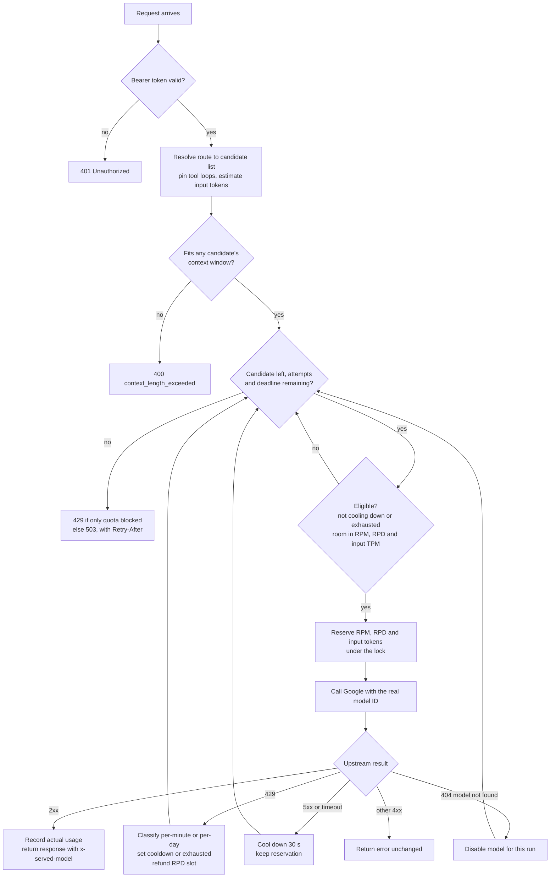
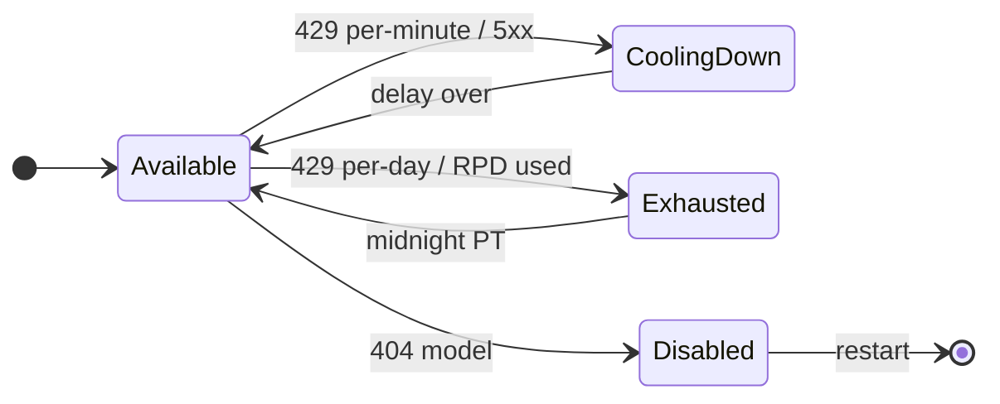
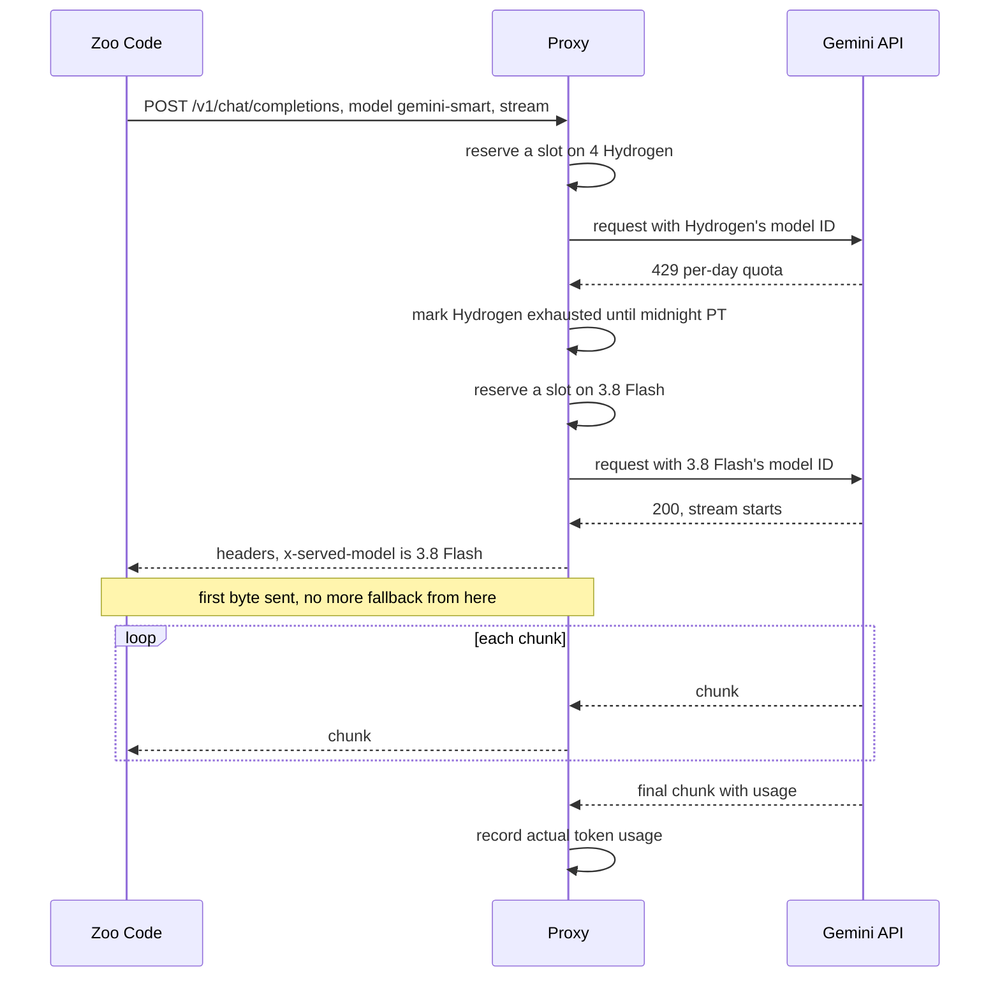

# Design: quota-aware fallback router for the Gemini API

Status: **revision 2, approved 2026-11-20** (after the first Phase 0 probe run and two
external reviews). Nothing is implemented yet.
Project name: `quota-router-for-gemini`. License: MIT.

## 0. v1 scope

v1 is deliberately small. Everything else in this document is the intended
direction, and is added only once v1 works and the probe supports it.

- **One route**, `gemini-fast`, with **one model**: Gemini 3.5 Flash Lite (500 RPD, 15 RPM).
  Gemini 3.1 Flash Lite (also 500 RPD) joins as the second candidate once it passes a tool
  call: in Phase 0 it returned 503 on all three tool-call requests (2026-11-20), and
  v1 traffic is mostly tool calls from Zoo Code. Until then, v1 has nothing to fall back to.
  The fallback logic is still built and tested in full against mocked upstreams.
- **One uvicorn worker.** Quota state lives in that process's memory.
- **One tested client**: Zoo Code.
- **Tool turns are pinned** to the model that made the tool calls (§5.1). There is no handoff
  between models in v1.
- Deferred until after v1: `gemini-smart`, Copilot Chat, Gemma.

The configuration format stays general (any number of models and routes), so adding
the deferred parts changes config, not code.

## 1. Problem

Google AI Studio's free tier sets limits for each model, in requests per minute (RPM),
tokens per minute (TPM) and requests per day (RPD). Coding agents such as Zoo Code make
many requests per task, so they use up a 20-RPD model within minutes. Most
OpenAI-compatible clients don't switch models when Gemini returns `429 RESOURCE_EXHAUSTED`.

The goal is one local OpenAI-compatible endpoint that sends each request to the best
model that still has quota. Every request stays within Google's published limits for
**one project and one API key**.

### Non-goals

- Raising limits. We never rotate several API keys, projects or accounts, and never
  retry to get past a limit. See [COMPLIANCE.md](COMPLIANCE.md).
- Hosting the proxy for other people. Each user runs their own instance with their own key.
- Translating between API formats. Google's OpenAI-compatible endpoint does that.
- Live API, TTS, embeddings, image, video or music models.

## 2. Quota inventory (one project, free tier, observed 2026-11-20)

These are the limits one project showed in AI Studio on 2026-11-20. They are a
**snapshot, not a constant**: limits differ between projects and change over time. Each
user copies their own project's active limits into `config.yaml`. Model IDs were confirmed
through `models.list` in Phase 0 ([probe-results.md](probe-results.md)).

TPM counts **input** tokens per minute. Output and reasoning tokens don't count
against it (§7).

| Display name | Model ID | RPM | TPM (input) | RPD | Role |
|---|---|---|---|---|---|
| Gemini 4 Hydrogen | `gemini-4-hydrogen` | 5 | 250K | 20 | smart |
| Gemini 3.8 Flash | `gemini-3.8-flash` | 5 | 250K | 20 | smart |
| Gemini 3.6 Flash | `gemini-3.6-flash` | 5 | 250K | 20 | smart |
| Gemini 3 Flash | `gemini-3-flash-preview` | 5 | 250K | 20 | smart / fast tail |
| Gemini 2.5 Flash | `gemini-2.5-flash` | 5 | 250K | 20 | smart / fast tail |
| Gemini 3.5 Flash Lite | `gemini-3.5-flash-lite` | 15 | 250K | 500 | fast (bulk), **v1** |
| Gemini 3.1 Flash Lite | `gemini-3.1-flash-lite` | 15 | 250K | 500 | fast (bulk); after its tool call passes |
| Gemini 2.5 Flash Lite | `gemini-2.5-flash-lite` | 10 | 250K | 20 | fast |
| Gemma 4 31B | `gemma-4-31b-it` | 30 | **16K** | 14.4K | probed in Phase 0; route added after v1 |
| Gemma 4 26B | `gemma-4-26b-a4b-it` | 30 | **16K** | 14.4K | probed in Phase 0; route added after v1 |

In that snapshot the Gemini text models total **about 1,120 RPD**. Gemma adds 28.8K RPD,
but only for prompts small enough to fit its 16K TPM.

Excluded:

- Models with a 0/0 quota.
- Robotics ER 2: a specialised preview model that adds only 20 RPD (about 2%). It is probed in
  Phase 0 but stays out of all routes.
- Antigravity and Decision API. These are separate products, not chat-completion models.
- Live API models. They use a separate real-time protocol, and using them for text
  would not be "the means described in the documentation".

Quotas change. The registry lives in `config.yaml`, not in code.

## 3. Architecture

```
client (Zoo Code, Copilot Chat, scripts)
   │  OpenAI Chat Completions, Authorization: Bearer <PROXY_TOKEN>
   ▼
┌──────────────────────── quota-router (127.0.0.1:4000) ───────────────────────┐
│ HTTP layer   FastAPI: /v1/chat/completions, /v1/models, /status, /healthz    │
│ Router       virtual model → ordered candidates → first eligible model       │
│ Quota store  per-model RPM/TPM windows + RPD counter + cooldown/exhausted    │
│              in memory; RPD, exhausted state, tool affinity in SQLite        │
│ 429 reader   decides whether the limit hit is per-minute, per-day or tokens  │
│ Upstream     httpx → https://generativelanguage.googleapis.com/v1beta/openai/│
└──────────────────────────────────────────────────────────────────────────────┘
```

Stack: Python 3.12, FastAPI + uvicorn, httpx, pydantic, PyYAML and stdlib `sqlite3`,
packaged as a Docker image with pinned, hash-locked dependencies.

## 4. Routes (virtual models)

The client picks a virtual model. Order is set in config; the defaults are:

| Route | Candidates in order | Intended use |
|---|---|---|
| `gemini-smart` | 4 Hydrogen → 3.8 Flash → 3.6 Flash → 3 Flash → 2.5 Flash → 3.5 Flash Lite → 3.1 Flash Lite → 2.5 Flash Lite | planning, debugging (Zoo Code Architect/Debug) |
| `gemini-fast` | 3.5 Flash Lite → 3.1 Flash Lite → 2.5 Flash Lite → 2.5 Flash → 3 Flash | edits, tool loops (Zoo Code Code/Ask); never uses the top three smart models |

v1 ships only `gemini-fast`, with just its first candidate (§0). The full lists above
are the target once v1 works. A `gemma-small` route for short prompts (Gemma 4 31B → 26B → `gemini-fast`)
will be added after v1 if Phase 0 shows Gemma works well enough; it needs routes that can fall back into other routes.

Requesting a real model ID directly sends the request to that model alone, with quota
tracking but no fallback.

## 5. Request flow



1. **Authenticate** the bearer token, using a constant-time comparison. Return 401 if it fails.
2. **Resolve** the route to its candidate list. If the request continues a tool loop,
   the list may be narrowed to one model (§5.1).
3. **Estimate** the input size: `input ≈ chars/4 × 1.2 safety margin`, counting messages and
   tool definitions. Only input counts against TPM. Output is checked separately:
   - *Context fit*: a candidate fits if `input ≤ min(input_limit, tpm_input)` and
     `max_tokens ≤ output_limit`. The limits come from `config.yaml` and are seeded from
     `models.list`. The TPM term matters: the Flash models accept 1M tokens of context, but
     a prompt over 250K could never fit their minute window. If no candidate fits, return `400` with code
     `context_length_exceeded` (the OpenAI convention, which clients use to trigger
     context condensing) without calling upstream.
4. **For each candidate**, while attempts and the deadline remain (§9):
   1. *Eligibility check* (under one `asyncio.Lock`): skip the model if it is
      `exhausted_until > now`, `cooldown_until > now`, RPM window is full, RPD counter is at
      its limit, the request doesn't fit its context, or `input` exceeds the free space in
      its TPM window. Skipping costs nothing; only real calls count as attempts.
   2. *Reserve* one RPM slot, one RPD slot and `input` tokens, still under the same lock.
      Reserving under the lock keeps parallel requests from over-committing.
   3. *Call upstream* with `model` rewritten to the real ID.
   4. *Outcome*:
      - **2xx**: replace the estimated token count with actual usage (see §7). Return the response.
      - **429**: classify it (§6) and set the cooldown or exhausted state. Refund the RPD
        reservation; Google's 429 is the source of truth. Keep the RPM slot, which is the
        conservative choice. Try the next candidate.
      - **500/502/503/504, connect error or timeout before the first byte**: set a short
        cooldown (30 s) and try the next candidate. Keep the reservation, because the
        request may still have used quota.
      - **400/401/403/404/422**: return the error to the client unchanged. It is the
        client's or the configuration's problem, and switching models won't fix it.
        Exception: a 404 "model not found" marks that model as disabled for this run
        (misconfiguration) and falls back.
5. **Nothing served the request.** Each candidate ends with exactly one reason:

   | Reason | Means | Can serve later? |
   |---|---|---|
   | `disabled` | 404 model not found earlier in this run | no (until restart) |
   | `too_large` | request doesn't fit its context, output or TPM limit | no |
   | `quota` | skipped for RPM, RPD, TPM, cooldown after a 429 or exhausted state, or it answered 429 | yes, at its `ready_at` |
   | `unavailable` | 5xx, timeout, or cooldown after a 5xx | yes, at its `ready_at` |
   | `not_tried` | attempts or deadline ran out before reaching it | yes, now |

   `ready_at` is the earliest moment the model could take *this* request: the latest of
   its cooldown end, exhausted-until, the next free RPM slot and the time its TPM window
   has room for this request's input.

   Rules, applied in order (candidates = after pinning):
   1. Every candidate is `disabled` or `too_large`: if any is `too_large`, return
      **400** `context_length_exceeded`. Otherwise (all `disabled`) return **503** with no
      `Retry-After` and code `no_enabled_model`, and log an error. This is a configuration
      fault, and retrying won't help.
   2. Otherwise, ignore the `disabled` and `too_large` candidates. If all the rest are
      `quota`: **429**.
   3. Otherwise (any `unavailable` or `not_tried`, or the deadline ran out): **503**.
   4. `Retry-After` (rules 2 and 3) = seconds until the earliest `ready_at` among the
      remaining candidates (`not_tried` counts as now), rounded up and at least 1.
      It is never derived from a model that can't serve the request.

   Errors are in OpenAI format, and the message lists each candidate with its reason.

Every response carries `x-served-model` and `x-fallback-path` (the models tried, in
order), so it is always visible when a weaker model answered.

Response bodies are passed through unchanged, including `finish_reason`. Gemini 3 and 4
return `finish_reason: "stop"` on tool calls, where 2.5 returns `"tool_calls"`. The proxy
doesn't rewrite it; Phase 4 checks that Zoo Code acts on `tool_calls` anyway.

Upstream error bodies can be a JSON **array** (`[{"error": {...}}]`); every 503 seen in
Phase 0 had that shape. Error parsing accepts both forms.

### 5.1 Tool loops and thought signatures

Gemini 3 and 4 attach a *thought signature* to each tool call. The client must send it
back with the tool result. If a function call in the current turn is missing its
signature, Google returns 400. Only the current turn is validated. Google documents a
placeholder signature (`skip_thought_signature_validator`) for history "transferred from a
different model", but doesn't say whether a real signature works on a different model.

Fallback inside a tool loop is therefore not assumed to be safe. The unit the proxy
pins is the **active turn**: every message after the last `user` message. One turn can
hold several assistant tool calls (a multi-step loop), and Google validates all of them.

- **Affinity record.** When the proxy serves a response that contains tool calls, it
  stores `tool_call_id → model` in SQLite (the same database as the quota state), kept
  for 24 hours. A Zoo Code task can wait a long time for the user to approve a tool, and
  a restart must not forget which model owns the turn.
- **Pinning.** If the active turn contains assistant tool calls, the proxy looks up their
  IDs. If they all map to one model, the candidates narrow to that model alone. If that model
  isn't eligible, the proxy returns 429 or 503 (§5) **without falling back**. A clear,
  retryable error is better than a 400 in the middle of a task.
- **Lost affinity**, handled explicitly:
  - *No ID in the turn is known* (record expired, or the call wasn't served by this
    proxy): route normally, and send `x-turn-affinity: unknown` on the response. Log a
    warning without any message content.
  - *IDs map to different models* (only possible after an earlier handoff): pin to the
    model of the **latest** tool call, and send `x-turn-affinity: mixed`.
  - A 400 from Google about a missing or invalid thought signature is returned to the
    client unchanged and is never retried on another model.
- **No handoff in v1.** Moving a tool turn between models is off for every pair. It may be
  enabled per pair (`handoffs:` in config, with `signature: keep|placeholder`) only after
  the probe shows a **multi-step** tool loop working across that pair: at least two tool calls in
  one turn, with the handoff between them, so that the earlier call's signature is
  validated by the second model. The single-step experiments in Phase 0 are evidence,
  not enough on their own.
- Tool-call fields, including `extra_content`, pass through unchanged. If Phase 0 shows
  that Zoo Code drops `extra_content`, the fallback plan is for the proxy to store each
  signature with its affinity record and re-attach it. That would be a design change to approve first.

## 6. Classifying 429s

Google does **not document** how a 429 tells you which limit was hit. Phase 0 records
real 429 bodies, and the classifier is built against those recordings. Planned behaviour:

| Signal (to be confirmed) | Meaning | Action |
|---|---|---|
| quota ID or message mentions per-**day** | RPD used up | `exhausted_until = next midnight America/Los_Angeles` |
| per-**minute** requests | RPM | `cooldown_until = now + retryDelay` (default 60 s) |
| **input tokens** per minute | TPM | same as RPM; also lower the model's free input-TPM space to zero for the window |
| unrecognised | unknown | cooldown 60 s, and log the raw body with the key removed so the classifier can be extended |

Each model moves between these states:



The daily reset uses `zoneinfo("America/Los_Angeles")`, so daylight saving is handled.
The day key is the PT calendar date.

## 7. Quota accounting

- **RPM/TPM**: a rolling 60-second window per model, kept in memory. Losing it on restart is
  harmless. The TPM window holds **input** tokens only: the estimate is reserved first, then
  replaced by the reported `prompt_tokens`. Models count prompts differently (Hydrogen
  reported 38 prompt tokens for a prompt the other models counted as 8), so the reported
  number always wins over the estimate.
- **Single process**: the windows and the lock live in one process, so the proxy runs
  with one uvicorn worker. More workers would each believe they had the full quota.
- **RPD**: a counter per (model, PT date), saved to SQLite so a restart doesn't forget it.
  `exhausted_until` is saved as well.
- **Local counts are only a hint.** Usage outside the proxy (AI Studio, other scripts)
  shares the same project quota. A 429 from Google always overrides the local state.
- **Actual usage**: from `usage` in non-streaming responses. For streams the proxy asks
  for `stream_options.include_usage`; every model in Phase 0 sent it, on the last content
  chunk. If upstream leaves it out, the proxy keeps the estimate.
- **Reasoning tokens** are not listed separately: `total_tokens` is larger than
  `prompt_tokens + completion_tokens` (for example 8 + 1 against 70). They don't count
  against TPM. `/status` and the log report output as `total_tokens − prompt_tokens`.

## 8. Streaming

Example: Zoo Code asks `gemini-smart` for a streamed answer after Hydrogen has used up its daily quota.



- The model can only be switched **before the first byte is sent to the client**.
  Rate-limit errors arrive before streaming starts, so this covers the main case.
- Once bytes have been sent, an upstream error ends the stream with an SSE error event.
  Responses from two models are never spliced together.
- If the client disconnects, the upstream request is cancelled and usage keeps its estimate.

## 9. Timeouts and limits

- Connect timeout 10 s. Time to first byte 120 s, because reasoning models are slow to start
  (Hydrogen took about 60 s on a one-word reply in Phase 0).
- **Request deadline 180 s** (configurable), measured from arrival to the first byte sent
  to the client. Each attempt's timeout is the smaller of 120 s and the time left. When
  it runs out, the proxy returns 503. Once streaming has started, the deadline no longer applies.
- **At most 3 upstream attempts per request** (configurable), and at most one per candidate.
  Skipping an ineligible candidate is not an attempt.
- Without these limits, a route of eight candidates could make one request wait about 16 minutes.
- Maximum request body 20 MB (configurable).

## 10. Security

- Binds to `127.0.0.1` by default. Docker publishes `127.0.0.1:4000:4000`, never `0.0.0.0`.
- `PROXY_TOKEN` is required. The proxy refuses to start without one, or with the
  placeholder value.
- `GEMINI_API_KEY` comes only from the environment or `.env`. It is never logged,
  echoed or put in error bodies; upstream error text is scrubbed of anything that looks like a key.
- Prompts and completions are **not logged**. Each request logs one line: time, route,
  path, status, token counts, latency.
- Raw 429 bodies captured for the classifier are stored with keys removed, under `data/`,
  which git ignores.

## 11. Endpoints

| Method and path | Purpose |
|---|---|
| `POST /v1/chat/completions` | main entry point; streaming and non-streaming |
| `GET /v1/models` | lists the routes and the real model IDs that are enabled |
| `GET /status` | for each model: RPM, TPM and RPD used/limit, cooldown and exhausted-until; next PT reset |
| `GET /healthz` | liveness check |

## 12. Configuration (`config.yaml`)

```yaml
upstream_base_url: https://generativelanguage.googleapis.com/v1beta/openai/
request_deadline_s: 180
max_attempts: 3
models:   # limits: copy your own project's values from AI Studio
  lite-3-5: { id: gemini-3.5-flash-lite, rpm: 15, tpm_input: 250000, rpd: 500,
              input_limit: 1048576, output_limit: 65536 }   # limits from models.list
  lite-3-1: { id: gemini-3.1-flash-lite, rpm: 15, tpm_input: 250000, rpd: 500,
              input_limit: 1048576, output_limit: 65536 }
routes:
  gemini-fast: [lite-3-5]   # add lite-3-1 once its tool call passes the probe
handoffs: []   # must stay empty in v1 (§5.1)
```

The `input_limit`/`output_limit` values are the ones `models.list` reported in Phase 0
([probe-results.md](probe-results.md)).

Secrets go in `.env` (`GEMINI_API_KEY`, `PROXY_TOKEN`), never in `config.yaml`.

## 13. Alternatives considered

| Option | Why not chosen |
|---|---|
| LiteLLM proxy | Mature, with ordered fallbacks and cooldowns, but it doesn't know about daily quotas: a model that is out for the day is re-tried after every fixed cooldown. Large dependency tree, and its PyPI package was reported compromised in 2026. Still a reasonable fallback plan. |
| Portkey Gateway, Bifrost | Same gap: they fall back on errors but don't track daily quotas or check request size against TPM first. |
| new-api / one-api | Built for multi-user resale; far more than this needs. |
| Calling the Gemini SDK in each script | Doesn't help clients we don't control (VS Code extensions). |

What decides it: Google's OpenAI-compatible endpoint means the proxy never translates
formats, so the custom part is only the routing and quota logic (an estimated 400–600 lines).

## 14. Failure-mode summary

| Situation | Behaviour |
|---|---|
| Parallel requests race for the last slot | reservation under one lock; one gets the slot, the other goes to the next model |
| Proxy restarts mid-day | RPD and exhausted state reload from SQLite; minute windows start empty (Google's 429 corrects any mistake) |
| Usage outside the proxy | local counts are low; the first 429 marks the model correctly |
| Daylight-saving change | reset computed in America/Los_Angeles with `zoneinfo` |
| Upstream fails mid-stream | SSE error event; no splicing; no fallback |
| Every model exhausted | 429 with `Retry-After` set to the earliest reset |
| Models overloaded (503 "high demand", common in Phase 0) | 30 s cooldown, next candidate; 503 when attempts or the deadline run out |
| Request larger than every candidate's context | 400 `context_length_exceeded`, no upstream call |
| Tool result arrives while its model is out of quota | 429/503, no fallback (no handoffs in v1, §5.1) |
| Proxy restarts in the middle of a tool turn | affinity reloads from SQLite; the turn stays on its model |
| Tool turn whose call IDs the proxy doesn't know | normal routing, `x-turn-affinity: unknown`, warning logged |
| Every candidate disabled (all 404) | 503 `no_enabled_model`, no `Retry-After` |
| Model ID renamed or retired | 404 → model disabled for this run, request falls back, warning logged |
| Google changes the 429 format | unknown 429s fall back to a 60 s cooldown and are captured for analysis |

## 15. Clients

All supported clients send OpenAI Chat Completions requests to `http://localhost:4000/v1`
and use `PROXY_TOKEN` as their API key.

### Zoo Code (primary client; continues Roo Code)
Official repo: https://github.com/Zoo-Code-Org/Zoo-Code. Its docs don't cover the
OpenAI Compatible provider yet; the steps below follow Roo Code's behaviour and need checking in Phase 4.

- Create two provider profiles (Settings → Providers → **+**). Both use **OpenAI Compatible**,
  Base URL `http://localhost:4000/v1` and API key `PROXY_TOKEN`:
  - profile `smart`, model ID `gemini-smart`
  - profile `fast`, model ID `gemini-fast`
- Set the context window to about **200000**, below the 250K TPM limit. Keep context condensing on.
- Assign profiles to modes. Zoo remembers the profile last used in each mode:
  Architect, Debug, Orchestrator → `smart`; Code, Ask → `fast`.
- Don't use the **LiteLLM** provider type. It expects LiteLLM-specific endpoints that this proxy doesn't implement.

### Cline / Kilo Code
Choose the "OpenAI Compatible" provider. Plan mode = `gemini-smart`, Act mode = `gemini-fast`.

### VS Code Copilot Chat (bring your own key)
Source: https://code.visualstudio.com/docs/agent-customization/language-models (read 2026-11-20).

- Setup: **Chat: Manage Language Models**, then **Add Models**, then **Custom Endpoint**, with API type
  **Chat Completions**. (The older "OpenAI Compatible" provider and the
  `github.copilot.chat.customOAIModels` setting are deprecated.)
- Configured in `chatLanguageModels.json`, provider `"vendor": "customendpoint"`. Each route needs
  `"toolCalling": true` or it won't appear in agent mode. Set `"maxInputTokens"` to
  about **200000**, below the 250K TPM limit; a larger request would be rejected
  no matter which model it goes to.
- Only covers chat, agent mode and utility tasks. Inline completions can't use a custom
  endpoint and keep using Copilot's own model.
- Business/Enterprise plans need the organisation policy "Bring Your Own Language Model Key
  in VS Code" turned on.
- Optional: point `chat.utilityModel` / `chat.utilitySmallModel` at `gemini-fast`.
  Those are small, frequent calls (titles, commit messages).

Compatibility requirements this places on the proxy: `/v1/models` must list the routes
(VS Code queries it when no `models` array is given), streaming must work, and tool-call
fields must pass through unchanged.
